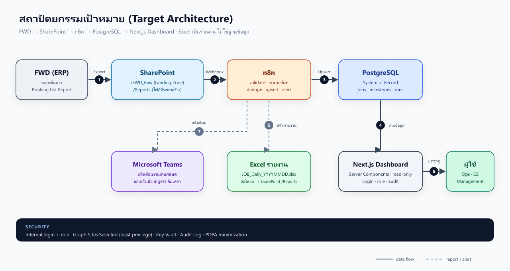

# แผนออกแบบระบบ Dashboard ติดตามสถานะงาน
## FWD → SharePoint → n8n → เว็บ Dashboard (Framework-based)

> **v0.2 update (28/10/2026):** เปลี่ยนสถาปัตยกรรมเป็น **Excel-first** ตามข้อกำหนด — ดู [FWD-Dashboard-Plan-v0.2-TH.md](FWD-Dashboard-Plan-v0.2-TH.md) เอกสารนี้เก็บไว้เป็นรายละเอียดการวิเคราะห์ไฟล์และตัวเลือกเดิม
>
> **v0.3 update (28/10/2026):** ถอด SharePoint ออก เปลี่ยนเป็น **Web-only** — ดู [FWD-Dashboard-Plan-v0.3-TH.md](FWD-Dashboard-Plan-v0.3-TH.md)

| | |
|---|---|
| **เวอร์ชัน** | 0.1 (ร่างเพื่อตรวจสอบ) |
| **วันที่** | 28 ตุลาคม 2026 |
| **ขอบเขต** | ออกแบบสถาปัตยกรรม + ความปลอดภัย + แผนดำเนินงาน ก่อนลงมือพัฒนา |
| **แหล่งข้อมูลที่ตรวจ** | `JOB_Daily_2026 STATUS_Dashboard.xlsx` (25 ชีต, 989 งาน), `2026 Booking Report.xlsx` (ตัวอย่าง export รายเดือนจาก FWD) |

> เอกสารนี้ยัง **ไม่ใช่การลงมือสร้างเว็บ** — เป็นแผนและข้อเสนอเพื่อให้ทีมยืนยันรายละเอียดก่อนพัฒนา

---

## 0. สรุปผู้บริหาร (Executive Summary)

**สิ่งที่พบ:** ไฟล์ Excel ที่ใช้อยู่ทำหน้าที่เป็นทั้งฐานข้อมูล เว็บรายงาน และหน้ากรอกข้อมูลในไฟล์เดียว ผลคือสูตร Dashboard อ้างช่วงข้อมูลไม่ครบ (นับได้สูงสุด ~352 งาน จากข้อมูลจริง 989 งาน) สถานะมี 9 รูปแบบที่เขียนต่างกัน มีงานซ้ำ 8 เลขงาน และมีวันที่ที่ parse ไม่ได้อีก 21 แถว — ตัวเลขบน Dashboard จึงขัดแย้งกันเอง (ยอดรวม 352 แต่ยอดตามสถานะรวม ~987)

**ข้อเสนอ:** ย้าย "แหล่งความจริง" (System of Record) ออกจาก Excel ไปเป็นฐานข้อมูล PostgreSQL แล้วให้เว็บ Dashboard (Next.js + TypeScript) อ่านจากฐานข้อมูลโดยตรง ส่วน SharePoint ยังเป็นจุดรับไฟล์ (Landing Zone) และ n8n ทำหน้าที่ตรวจสอบ–แปลง–โหลดข้อมูล ซ้ำได้โดยไม่สร้างข้อมูลซ้ำ (Idempotent) สำหรับ Excel ให้เปลี่ยนบทบาทเป็น "รายงานที่ระบบสร้างให้" และ/หรือ "หน้ากรอกข้อมูลช่วงเปลี่ยนผ่าน" ไม่ใช่ฐานข้อมูลอีกต่อไป

**ผลลัพธ์ที่คาดหวัง**

| ตัวชี้วัด | ปัจจุบัน | เป้าหมาย |
|---|---|---|
| ความสดของข้อมูล | ต้อง export/วางไฟล์/แก้สูตรเอง | ภายใน 15 นาทีหลังไฟล์ลง SharePoint |
| งานที่ต้องคีย์มือ | ทุกครั้งที่อัปเดต | ลดลง ≥ 80% |
| ตัวเลขบน Dashboard | คลาดเคลื่อนจากสูตรอ้างช่วงผิด | ตรงกับต้นทาง 100% (มี reconciliation test) |
| สิทธิ์การเข้าถึง | ไฟล์ SharePoint/Excel | Login + Role-based + Audit log |
| ข้อมูลซ้ำ | 8 เลขงาน | 0 (unique key + upsert) |

**ระยะเวลา:** 10–12 สัปดาห์ถึง Go-live (MVP) ด้วยทีม 2 คน (Full-stack 1 + Automation/Data 1) และมีเจ้าของงานฝั่ง Operations 1 คน
**งบประมาณโครงสร้างพื้นฐาน (ประมาณการ):** ~5,000–7,000 บาท/เดือน บน Azure (App Service + PostgreSQL + Key Vault + VM สำหรับ n8n)

**สิ่งที่ต้องตัดสินใจก่อนเริ่ม (9 ข้อ):** ดูหัวข้อ 13 — ที่สำคัญที่สุดคือ (1) FWD export อัตโนมัติได้หรือไม่ (2) Excel ยังต้องแก้มือหรือไม่ (3) n8n จะโฮสต์ที่ไหน

---

## 1. ข้อเท็จจริงจากไฟล์ตัวอย่าง

### 1.1 โครงสร้างไฟล์

| ชีต | สถานะ | จำนวนงาน/แถว | บทบาท |
|---|---|---|---|
| `SEA Import` | แสดง | 484 งาน (แถว 4–512) | งานนำเข้าเรือ |
| `AIR Import` | แสดง | 233 งาน (แถว 4–237) | งานนำเข้าอากาศ |
| `Air Export` | แสดง | 25 งาน (แถว 4–28) | งานส่งออกอากาศ (น้อยผิดปกติ) |
| `SEA Export` | แสดง | 247 งาน (แถว 4–250) | งานส่งออกเรือ |
| `Transport` | แสดง | 549 เที่ยว | ขนส่ง/ตู้/รถ |
| ` Freight ` | แสดง | 108 งาน | ชีตรวมแบบมีคอลัมน์ `AIR / SEA` (ใกล้ schema เป้าหมายที่สุด) |
| `clearing` | ซ่อน | ~27 รายการ (23 งาน) | Advance / Clearing (แต่ละงานกิน 3 แถว) |
| `Dashboard` | **ซ่อน** | — | 5 charts + สูตรสรุป |
| `consignee`, `waiting`, `mail`, `MSG line OA`, `Sheet1–11` | ซ่อน | — | รายงาน/พื้นที่ทำงาน/รูปภาพ |
| **รวมงาน (4 ชีตหลัก)** | | **989 งาน** | |

### 1.2 ข้อค้นพบที่กระทบการออกแบบ

1. **ไม่มี Excel Table (ListObject) แม้แต่ตารางเดียว** — ทุกชีตเป็น range ธรรมดา ทำให้ node `Microsoft Excel` แบบ `upsert` ที่ต้องระบุ `table` ใช้ไม่ได้กับไฟล์นี้
2. **Dashboard ถูกซ่อนอยู่** (`state = hidden`) และมี 5 charts
3. **สูตร Dashboard อ้างช่วงข้อมูลไม่ครอบคลุม:**
   - `SEA Import` ใช้ `D8:D151` แต่ข้อมูลจริงถึงแถว 512
   - `AIR Import` ใช้ `D4:D72` แต่ข้อมูลจริงถึงแถว 237
   - `SEA Export` ใช้ `G5:G118` แต่ข้อมูลจริงถึงแถว 250
   - ผลคือ `C10` (Total) ได้สูงสุด ~352 งาน แต่ `H10` (ยอดตามสถานะ ซึ่งอ้างทั้งคอลัมน์) ได้ ~987 → **Dashboard ขัดแย้งกันเอง**
4. **สถานะเขียนได้ 9 แบบ:** `Job Complete`, `Job complete`, `job complete`, `Job Control`, `Job Waiting`, `Job Cancelled`, `Job canceled`, `CANCELED`, `ยกเลิก Job` (แบบสุดท้ายถูกนับเป็น In Progress เพราะไม่มีคำว่า cancel)
5. **ข้อมูลไม่ครบ:** ETD หาย 49 แถว, วันที่ parse ไม่ได้ 21 แถว, ชื่อลูกค้าหาย 3 แถว, ETA หาย 14 แถว
6. **งานซ้ำ 8 เลขงาน** เช่น `AE26070001` (ยกเลิกแล้วจองใหม่), `SHAE26090007`, `SI26070006` → ต้องใช้ composite key ไม่ใช่ `job_no` เดี่ยว
7. **ข้อมูลในชีตอาจถูกเคลียร์/ลบ:** `Air Export` เหลือ 25 แถว แต่สูตรอ้างถึงแถว 119 → ต้องมี "data drift alert"
8. **`clearing` ไม่ใช่ตาราง:** 1 รายการเบิกกิน 3 แถว (Adv. No./วันที่/จำนวนวัน) → ต้องแปลงเป็นตาราง `advances` ก่อนใช้

### 1.3 สรุปภาพรวมข้อมูล ณ วันที่ตรวจ

| สถานะ | จำนวน | สัดส่วน |
|---|---|---|
| Completed | 891 | 90.1% |
| In Progress (Control 74 + Waiting 12 + ยกเลิก Job 2) | 88 | 8.9% |
| Cancelled | 10 | 1.0% |
| **รวม** | **989** | 100% |

> ตัวเลข 90% Complete ไม่ได้หมายความว่างานเสร็จเร็ว — เพราะไฟล์เก็บงานย้อนหลังหลายเดือน และงานที่ยังไม่จบส่วนใหญ่อยู่ใน monthly sheet ล่าสุด การอ่าน KPI ต้องกรองตามช่วง ETD/เดือนเสมอ

### 1.4 คุณภาพข้อมูลเชิงกระบวนการ (สำคัญต่อการออกแบบ)

การเช็ก "คอลัมน์ขั้นตอนงาน" (milestone) ในไฟล์พบว่าถูกกรอกไม่สม่ำเสมอ:

| Milestone | กรอกแล้ว | คิดเป็น | หมายเหตุ |
|---|---|---|---|
| Draft ใบขน | 516 / 989 | 52% | งานที่ Complete แล้วแต่ไม่มี draft 387 งาน |
| ยิงใบขนจริง | 389 / 989 | 39% | |
| แลก DO | 259 / 989 | 26% | งาน Complete แต่ไม่มี DO 642 งาน |
| Clear & Pickup | 626 / 989 | 63% | |
| เอกสารเบิกเงิน Shipping | 42 / 989 | 4% | ส่วนใหญ่อยู่ในชีต `clearing` แยก |

ผลต่อการออกแบบ:

- **ห้ามเดา "ขั้นตอนถัดไป" จากช่องว่าง** — ถ้าคอลัมน์ว่าง อาจหมายถึง "ยังไม่ทำ" หรือ "ไม่ได้บันทึก" ซึ่งแยกกันไม่ได้ ต้องแสดงเป็น "ไม่มีข้อมูล" และให้เจ้าของงานยืนยัน
- **ต้องมี Data Health** ให้เห็นว่า milestone ไหนกรอกครบกี่ % และแจ้งเตือนเมื่อต่ำกว่าเกณฑ์
- **ลูกค้าชื่อตัวเอง (SAVE LOGISTICS) คิดเป็น 599 งาน (60.6%)** — Top 10 Customer ต้องแยกบริษัทในเครือออก ไม่เช่นนั้นกราฟจะไม่มีความหมาย
- **งานค้างเกินกำหนด (ETD ผ่านไปแล้วแต่ยัง In Progress) = 75 งาน** — เป็น KPI ที่ควรมีบนหน้าแรกจริง แต่ต้องตกลงนิยามกับ Operations ก่อน

---

## 2. วิเคราะห์กระบวนการเดิม 3 ขั้นตอน

| ขั้นตอน | สิ่งที่ทำอยู่ | ปัญหา | ข้อเสนอ |
|---|---|---|---|
| **1. Export จาก FWD** | คนกด export เป็น Excel/CSV | เวลาไม่แน่นอน, ไฟล์ผิดเวอร์ชัน, ไม่มี audit, ลืม export | ตั้ง scheduled export ใน FWD ถ้าทำได้; ถ้าไม่ได้ใช้ Power Automate Desktop/RPA; ตั้งชื่อไฟล์ `FWD_Booking_YYYYMMDD_HHmm.xlsx` + เก็บ hash; ตรวจความครบ (row count/header/date range) ก่อนรับ |
| **2. วางไฟล์ลง SharePoint** | วางใน library/โฟลเดอร์ | โฟลเดอร์ปนกับเอกสารอื่น, สิทธิ์กว้าง, ไม่มี retention, n8n ต้อง polling | แยก library `FWD_Raw` + `Reports`; ตั้ง metadata (export date, source, hash); เปิด versioning + sensitivity label + retention 90 วัน; ใช้ Graph webhook แจ้ง n8n ทันทีที่ไฟล์เข้า; ให้สิทธิ์ app-only แบบ `Sites.Selected` เฉพาะ site นี้ |
| **3. n8n อัปเดต Excel** | upsert ลง Excel Online | ไฟล์ไม่มี Table, ชื่อคอลัมน์ไม่ตรง, เขียนทับกันตอนคนเปิดไฟล์, สูตรพัง, ไม่มี idempotency | **ไม่ให้เว็บอ่าน Excel**; n8n โหลดเข้า PostgreSQL เป็นหลัก; Excel เป็นรายงานที่สร้างใหม่ หรือเขียนเฉพาะคอลัมน์ master ผ่าน Office Script (ดูหัวข้อ 6) |

### 2.1 ปัญหาใน workflow n8n ที่มีอยู่ (`FWD_Logistics_Dashboard_Pipeline.json`)

| # | ปัญหา | ผลกระทบ |
|---|---|---|
| 1 | ใช้ node `microsoftOneDrive` ดาวน์โหลดไฟล์ SharePoint | ดึงไฟล์ผิด drive/ไม่ทำงาน |
| 2 | `fileId` เป็น placeholder คงที่ | ต้องแก้มือทุกครั้ง |
| 3 | อ่าน workbook ด้วย `spreadsheetFile` แล้วสมมติว่ามีคอลัมน์ `JOB NO.`, `STATUS JOB` | ไฟล์จริงมีหัวตาราง 3 แถวและชื่อคอลัมน์ต่างกัน |
| 4 | เขียน Excel ด้วย `table` ที่ไม่มีอยู่จริง | node ล้มเหลว |
| 5 | `keyColumn: "Job No."` ไม่ตรงกับหัวจริง (`JOB NO`, `create job no.`) | upsert ผิดแถว |
| 6 | เขียน JSON ลง `c:/Users/User/...` | ใช้บนเซิร์ฟเวอร์ไม่ได้ และข้อมูลไม่อยู่ในที่ควบคุม |
| 7 | Trigger ทุก 1 ชั่วโมงโดยไม่เช็กว่าไฟล์ใหม่หรือไม่ | ทำงานซ้ำ/เปลือง resource |
| 8 | ไม่มี validation, dedupe, quarantine, error workflow | ข้อมูลเสียหลุดเข้าระบบเงียบ ๆ |

---

## 3. สถาปัตยกรรมเป้าหมาย

### 3.1 ภาพรวม



*ภาพที่ 1 — เส้นทึบ = การไหลของข้อมูล, เส้นประ = รายงาน/การแจ้งเตือน (ไฟล์ต้นฉบับ: `architecture.svg`)*


### 3.2 หลักการออกแบบ 6 ข้อ

1. **Single Source of Truth** — ฐานข้อมูลคือความจริง; Excel และเว็บเป็นผู้แสดงผล
2. **Idempotent by design** — รันซ้ำกี่ครั้งก็ได้ผลเท่าเดิม (unique key + hash + upsert)
3. **Least privilege** — n8n เข้าถึง SharePoint ได้เฉพาะ site เดียว, เว็บใช้ DB role แบบอ่านอย่างเดียว
4. **Observable** — ทุกการนำเข้าเขียน `ingest_runs`; แจ้งเตือนเมื่อล้มเหลว/ข้อมูลผิดปกติ
5. **Excel as a view** — ไม่ให้ Excel เป็นฐานข้อมูลและไม่ให้เว็บอ่าน Excel โดยตรง
6. **Security by design** — Login + role, secrets ใน Key Vault, ไม่มี PII ใน log, audit การเข้าถึง

### 3.3 องค์ประกอบและหน้าที่

| องค์ประกอบ | หน้าที่ | หมายเหตุ |
|---|---|---|
| SharePoint Online | รับไฟล์ดิบ, เก็บรายงาน, เป็นที่แชร์ให้ทีม | แยก library `FWD_Raw` และ `Reports`; เปิด versioning |
| n8n (self-hosted) | Orchestration: ดึงไฟล์, ตรวจ, แปลง, โหลด, แจ้งเตือน | ไม่เปิด public; อยู่หลัง reverse proxy + internal auth |
| PostgreSQL 16 | เก็บ jobs, milestones, transport, advances, ingest log | Azure Flexible Server + private endpoint |
| Next.js 16 | เว็บ Dashboard + API (read-only) | App Router, TypeScript, Tailwind |
| Internal Auth | Login + role (local account หรือ Windows AD) | ไม่ใช้ Entra SSO สำหรับผู้ใช้; n8n ยังใช้ Entra app-only สำหรับ SharePoint |
| Azure Key Vault | เก็บ secrets/certificates | ใช้ managed identity |
| Application Insights | log/metrics/alerts | p95 latency, error rate, ingest failure |
| Power Automate + Office Script | (ทางเลือก) เขียน Excel แบบ in-place | ใช้บัญชี service account |

---

## 4. ทางเลือกสถาปัตยกรรม (Trade-off)

| | **A. Excel-first** (แผนเดิม + เว็บอ่านสำเนา) | **B. DB-first** (แนะนำ) | **C. Power Platform** |
|---|---|---|---|
| แหล่งความจริง | Excel | PostgreSQL | Dataverse / SharePoint List |
| เว็บ | Next.js อ่าน JSON/DB ที่ mirror จาก Excel | Next.js อ่าน PostgreSQL | Power BI / Power Apps |
| n8n | เขียน Excel เป็นหลัก | เขียน DB เป็นหลัก, Excel เป็นรายงาน | Power Automate แทน n8n |
| ข้อดี | เปลี่ยนน้อย, ทีมคุ้นเคย, เห็นผลเร็ว | ข้อมูลนิ่ง, เร็ว, ตรวจสอบได้, ขยายต่อได้ | ไม่ต้องเขียนโค้ด, integrate M365 ดี |
| ข้อเสีย | สูตรพังง่าย, เขียนชนกัน, ไม่มี history, สเกลไม่ได้ | ต้องสร้าง DB/เว็บ/ย้ายการกรอกข้อมูล | ค่า license ต่อผู้ใช้, ปรับ UI ยาก, ผูกกับ Microsoft |
| เหมาะกับ | เปลี่ยนผ่าน 1–2 เดือน | ระยะยาว (แนะนำ) | องค์กรที่ต้องการ no-code และมีงบ license |
| ประมาณการ | 3–4 สัปดาห์ | 10–12 สัปดาห์ | 4–6 สัปดาห์ (แต่ค่าใช้จ่ายต่อเนื่อง) |

**ข้อแนะนำ: B (DB-first) + ใช้ A เป็นสะพานช่วงเปลี่ยนผ่าน**
เหตุผล: ข้อมูล 989 งานไม่ได้ใหญ่โตอะไร การใช้ Excel เป็นฐานข้อมูลสร้างปัญหาเชิงโครงสร้างที่แก้ไม่จบ (สูตรอ้างช่วงผิด, ไฟล์ถูกล็อก, ไม่มี audit) การลงทุนทำ DB + เว็บครั้งเดียวจะรองรับการเติบโตอีกหลายปี และยังส่งออก Excel ให้ทีมที่ถนัด Excel ได้ทุกเมื่อ

> ถ้าทีมพัฒนาไม่มีประสบการณ์ JavaScript/TypeScript และถนัด PHP มากกว่า สามารถใช้ **Laravel + Inertia + Vue** แทน Next.js ได้ โดยสถาปัตยกรรมที่เหลือเหมือนเดิม

---

## 5. โมเดลข้อมูล (Canonical Schema)

### 5.1 ตารางหลัก

| ตาราง | คีย์ | ฟิลด์สำคัญ | แหล่งข้อมูล |
|---|---|---|---|
| `jobs` | `job_no` + `service_code` + `revision` | status, customer_id, customer_name_raw, consignee, bl_no, etd, eta, job_date, source_file_id, source_row, first_seen_at, updated_at, is_deleted | FWD export + 4 ชีตงาน |
| `job_milestones` | `job_id` + `milestone_code` | planned_date, actual_date, status, updated_by, updated_at | คอลัมน์ manual ใน Excel / เว็บ |
| `customers` | `id` | name, normalized_name, aliases, is_active | jobs (distinct) |
| `transport_jobs` | `transport_no` | job_no, container_type, truck_type, deliver_date, completed_at, acc_status | `Transport` |
| `advances` | `adv_no` | job_no, amount, adv_date, clear_date, clearing_no, days_outstanding | `clearing` |
| `ingest_runs` | `id` | file_id, file_name, file_hash, rows_read, rows_upserted, rows_rejected, status, error, started_at, finished_at | n8n |
| `audit_log` | `id` | user_id, action, entity, entity_id, ip, user_agent, created_at | เว็บ |
| `users` / `roles` | `id` | email, password_hash, display_name, role (viewer/ops/admin), is_active | admin assignment / AD group |

### 5.2 Milestone ที่ต้องมี (รวม 4 ชีตให้เป็นมาตรฐานเดียว)

| Milestone | ความหมาย | คอลัมน์ใน SEA Import | AIR Import | Air Export | SEA Export |
|---|---|---|---|---|---|
| `draft_customs` | draft ใบขน | H | H | J | K |
| `customs_filed` | ยิงใบขนจริง | O | M | Q | Q |
| `do_released` | แลก DO | N | L | P | T |
| `cleared` | Clear & Pickup | P | N | R | S |
| `advance_doc` | เอกสารเบิกเงิน Shipping | L | J | N | O |
| `invoice` | Invoice/CUS.INV | — | — | — | — (มาจาก FWD) |

> ชีต ` Freight ` มีคอลัมน์ `AIR / SEA` อยู่แล้ว จึงเป็นโครงที่ควรใช้เป็นต้นแบบของ "one row per job" มากกว่าการแยก 4 ชีต

### 5.3 การแมปจาก FWD export

| คอลัมน์ FWD (Booking List Report) | ฟิลด์ใน `jobs` | หมายเหตุ |
|---|---|---|
| `JOB NO.` | `job_no` | normalize: trim, upper, ตัด `(SEA)` |
| `Type` (SHAE/SHAI/SE/SI/TS) | `service_code` | ใช้ classify แทนการแยกชีต |
| `STATUS JOB` | `status` | map ผ่าน enum |
| `CUSTOMER NAME` | `customer_name_raw` | join `customers` แบบ fuzzy |
| `ETD`, `ETA` | `etd`, `eta` | parse หลายรูปแบบ → `date` |
| `CUS.INV NO` | `invoice_no` | |
| `MBL`, `HBL` | `mbl_no`, `hbl_no` | |
| `DEPO PORT`, `TERMINAL`, `PLACE OF DELIVERY` | `port`, `terminal`, `place_of_delivery` | ใช้ทำ filter |
| `G.W.`, `NO. OF PACKAGES` | `gross_weight`, `packages` | |

### 5.4 กติกาการ normalize

| เรื่อง | กติกา |
|---|---|
| Status | enum: `COMPLETED`, `IN_PROGRESS`, `CANCELLED`, `BOOKING`, `UNKNOWN` + เก็บ `status_raw` ไว้ตรวจ |
| วันที่ | รองรับ `DD/MM/YYYY`, `D/M/YY`, `YYYY-MM-DD`, `DD/MM` (ปีปัจจุบัน), Excel serial; ค่าที่ parse ไม่ได้ → `NULL` + ใส่ quarantine |
| Job No | regex `[A-Z]{2,4}\d{8}`; ถ้าไม่ตรง → quarantine |
| ลูกค้า | trim, collapse space, ตัด `Co.,Ltd.` เพื่อจับกลุ่ม; เก็บชื่อดิบ |
| งานซ้ำ | unique `(job_no, service_code, etd)`; ถ้าซ้ำแต่คนละ ETD → ถือเป็น revision ใหม่ เก็บประวัติ |
| แถวเสีย | ไม่ทิ้งเงียบ ๆ → `quarantine_rows` + รายงานในหน้า Data Health |

### 5.5 Index และประสิทธิภาพ

- Index: `jobs(job_no)`, `jobs(etd)`, `jobs(status)`, `jobs(customer_id)`, `jobs(service_code, etd)`
- Materialized view: `mv_kpi_daily`, `mv_customer_top` (refresh หลัง ingest)
- ด้วยข้อมูล ~1,000 งาน/ปี + ย้อนหลัง 2–3 ปี (ไม่เกิน 100k แถว) PostgreSQL รับได้สบาย

---

## 6. Excel จะอยู่ตรงไหน (สำคัญ)

### 6.1 ทางเลือก 3 ระดับ

| ระดับ | วิธี | ข้อดี | ข้อเสีย | แนะนำ |
|---|---|---|---|---|
| **E1: Read-only** | n8n อ่าน Excel (รวมคอลัมน์ manual) → DB; ไม่เขียนกลับ | เสี่ยงต่ำสุด, คนยังทำงานใน Excel ได้ | ต้องมีคนอัปเดต Excel เอง; ข้อมูลอาจ stale; พิมพ์ซ้ำ | ใช้ช่วง 2–4 สัปดาห์แรก |
| **E2: Hybrid writeback** | n8n อัปเดตเฉพาะคอลัมน์ master (status/ETD/ETA/customer/BL) ในชีตงานผ่าน Office Script; คอลัมน์ manual ไม่แตะ | ตอบโจทย์ "n8n อัปเดต Excel" โดยไม่ทับงานคน | ต้องสร้าง Table/Office Script; จัดการ lock; ต้องมี service account | **แนะนำช่วงเปลี่ยนผ่าน** |
| **E3: Generated report** | ระบบสร้างไฟล์ใหม่จาก template ทุกเช้า → `/Reports/`; คนแก้ข้อมูลบนเว็บ | สะอาด, audit ครบ, ไม่มี write conflict | ต้องย้ายนิสัยการกรอกข้อมูลไปเว็บ | **เป้าหมายระยะยาว** |

### 6.2 ทำไมไม่เขียนทับ Excel ตรง ๆ ด้วย node Microsoft Excel

- ไฟล์ไม่มี Excel Table → `upsert` ของ node ต้องมี Table
- Excel Online ล็อกไฟล์ชั่วคราวเมื่อมีคนเปิด → API ตอบ `409/423`
- สูตรและ merged cells เสี่ยงเสียหายเมื่อเขียนทั้งแถว
- ไม่มี transaction/rollback
- เขียนพร้อมกันหลายรอบทำให้ข้อมูลเพี้ยน

### 6.3 แนวทาง E2 ที่ปลอดภัย

1. เพิ่มตาราง `tblJobsSync` (Excel Table) ในชีตใหม่ `FWD_Sync` เก็บเฉพาะ master fields + `synced_at`
2. สร้าง Office Script `upsertJobsFromPayload` (TypeScript) รับ JSON → หา job_no → update/append → คืนสรุปจำนวน
3. n8n เรียกผ่าน Power Automate HTTP trigger (บัญชี service account) หรือ Graph `/workbook/scripts/{id}/run`
4. เขียนเฉพาะคอลัมน์ที่กำหนด; คอลัมน์ manual ทั้งหมดอยู่ในชีตงานเดิมและไม่ถูกแตะ
5. ถ้าต้องการให้ Dashboard เดิมแสดงผล ให้แก้สูตรให้อ่าน `tblJobsSync` แทน range ตายตัว

### 6.4 ข้อปรับปรุง template ที่ควรทำก่อนใช้ต่อ

- [ ] ยกเลิกการซ่อนชีต `Dashboard` และลบ Helper columns ที่ซ่อน (L:O)
- [ ] เปลี่ยนสูตร `COUNTA/COUNTIF` ให้อ้างเต็มคอลัมน์หรือ Excel Table
- [ ] สร้าง Excel Table ให้ทุกชีตงาน (`tblSeaImport`, `tblAirImport`, ...)
- [ ] ลบ/เก็บชีตซ้ำ (`Sheet1–11`, `mail`, `s`, `Sheet11`) ออกจากไฟล์ production
- [ ] เพิ่มชีต `Data_Health` แสดงจำนวนแถวที่รับเข้า/ปฏิเสธ/วันที่อัปเดต
- [ ] กำหนดเจ้าของคอลัมน์: master (ระบบเขียน) vs manual (คนเขียน) ให้ชัด

---

## 7. การออกแบบ n8n Workflow

### 7.1 ลำดับการทำงาน

| # | Node | หน้าที่ | รายละเอียด |
|---|---|---|---|
| 1 | Graph Webhook / Schedule | Trigger | webhook เมื่อมีไฟล์ใหม่ + fallback cron ทุก 30 นาที |
| 2 | Graph: list children | หาไฟล์ล่าสุด | `$filter=lastModifiedDateTime gt ...`, `$orderby=lastModifiedDateTime desc` |
| 3 | Code: เลือกไฟล์ | กันไฟล์ซ้ำ | เทียบ `file_hash` กับ `ingest_runs` |
| 4 | Graph: download | ดาวน์โหลด | เก็บใน temp volume เท่านั้น |
| 5 | Spreadsheet File | อ่าน XLSX | ระบุ sheet/header row ให้ถูก |
| 6 | Code: validate schema | ตรวจหัวตาราง | ถ้า header ไม่ครบ → fail พร้อมข้อความ |
| 7 | Code: normalize | แปลงค่า | status/date/job_no/customer |
| 8 | IF rows > 0 | กันกรณีไม่มีข้อมูล | |
| 9 | Postgres: upsert | เขียน DB | `INSERT ... ON CONFLICT ... DO UPDATE` ใน transaction |
| 10 | Postgres: merge milestones | รวมข้อมูล manual | จาก Excel ที่อ่านไว้ |
| 11 | Postgres: log run | `ingest_runs` | สำเร็จ/ล้มเหลว/จำนวนแถว |
| 12 | HTTP: revalidate | แจ้งเว็บ | `POST /api/revalidate` พร้อม HMAC |
| 13 | HTTP: Teams | แจ้งเตือน | เมื่อมี rejects > threshold หรือ run fail |

### 7.2 Error handling

- Retry 3 ครั้งแบบ exponential (30s, 2m, 10m) เฉพาะ network/5xx
- Error Trigger workflow → Teams + email + เขียน `ingest_runs.status='failed'`
- ถ้า rejects > 5% → หยุดรับไฟล์นั้นและแจ้งเตือน (ไม่โหลดข้อมูลครึ่ง ๆ กลาง ๆ)
- ใช้ transaction เดียวต่อไฟล์; ถ้าล้มเหลวให้ rollback ทั้งชุด

### 7.3 Idempotency

- `file_hash = SHA-256(file bytes)` → ถ้าเคยสำเร็จแล้ว ข้าม
- `row_hash = SHA-256(job_no|service|etd|status|...)` → ตรวจการเปลี่ยนแปลง
- unique constraint ที่ DB เป็นด่านสุดท้าย

### 7.4 ความปลอดภัยของ n8n

| Setting | ค่าแนะนำ |
|---|---|
| `N8N_ENCRYPTION_KEY` | สุ่ม 32 bytes เก็บใน Key Vault ( backup ด้วย) |
| `N8N_HOST` | internal hostname เท่านั้น |
| `N8N_SECURE_COOKIE` | `true` |
| `N8N_BLOCK_ENV_ACCESS_IN_NODE` | `true` |
| `N8N_BLOCK_FILE_ACCESS_TO_N8N_FILES` | `true` |
| `N8N_RESTRICT_FILE_ACCESS_TO` | เฉพาะ `/data/tmp` |
| `EXECUTIONS_DATA_PRUNE` | `true`, เก็บ 7 วัน |
| `N8N_DIAGNOSTICS_ENABLED` | `false` |
| `N8N_COMMUNITY_PACKAGES_ENABLED` | `false` |
| Login | local account (Argon2id) หรือ LDAPS กับ AD ภายใน; ปิด basic auth |
| Reverse proxy | internal auth + IP allowlist + WAF |
| Public API | ปิด หรือใส่ token + rate limit |

### 7.5 Deployment

- Docker Compose บน VM (Azure B2s) หรือ Azure Container Apps
- Volume สำหรับ `~/.n8n` + backup รายวัน
- Healthcheck `/healthz`
- อัปเดตเวอร์ชันทุก 1–2 เดือน (ติดตาม CVE)

---

## 8. การออกแบบเว็บไซต์ (Framework)

### 8.1 Stack ที่แนะนำ

| ชั้น | เทคโนโลยี | เหตุผล |
|---|---|---|
| Framework | **Next.js 16 (App Router) + TypeScript** | SSR/Server Components ทำให้ query DB ฝั่งเซิร์ฟเวอร์, ไม่ต้องเปิดเผย DB ให้ browser, ecosystem ใหญ่, deploy ง่าย |
| UI | Tailwind CSS + shadcn/ui | ควบคุมดี, consistency, accessibility |
| Charts | Recharts หรือ ECharts | ตอบโจทย์ donut/stacked bar/line |
| Table | TanStack Table | sort/filter/pagination ฝั่ง client + server |
| Validation | Zod | ใช้ร่วมกับ API และ form |
| ORM | Drizzle หรือ Prisma | migration + type safety |
| Auth | Auth.js (NextAuth) + Credentials/LDAP | local account หรือ Windows AD |
| Testing | Vitest + Playwright | unit + e2e |
| CI/CD | GitHub Actions → Azure App Service | staging slot + smoke test |

> เหตุผลที่เลือก Next.js แทน vanilla JS: ระยะยาวต้องมี auth, server-side query, API, migration, testing — framework พร้อมให้ทั้งหมด ลดโค้ดที่ต้องดูแลเอง

### 8.2 โครงสร้างหน้า

| Route | ผู้ใช้ | เนื้อหา |
|---|---|---|
| `/overview` | ทุกคน | KPI, charts, exception queue, freshness |
| `/jobs` | Ops/CS | ตารางค้นหา/filter/sort/export |
| `/jobs/[jobNo]` | Ops/CS | timeline, เอกสาร, transport, advance, history |
| `/transport` | Ops | ตู้/เที่ยว/สถานะส่งของ |
| `/advances` | Shipping/Accounting | aging, เกินกำหนด, clearing status |
| `/data-health` | Admin | ingest runs, rejects, duplicates, stale |
| `/admin` | Admin | users/roles, settings |

### 8.3 Wireframe หน้า Overview

```
┌──────────────────────────────────────────────────────────────────────┐
│ SAVE Logistics   ภาพรวมงาน          [ค้นหา Job/BL/ลูกค้า]  [ผู้ใช้ ▾] │
├────────────┬─────────────────────────────────────────────────────────┤
│ ภาพรวม     │  งานทั้งหมด 989   อัตราปิดงาน 90.1%  กำลังทำ 88  เกินกำหนด 75 │
│ งานทั้งหมด │  ↑ 4 KPI cards + เทรนด์ 7 วัน                                 │
│ ขนส่ง      ├──────────────────────────────┬──────────────────────────┤
│ เบิกเงิน   │  งานตามบริการ (stacked bar)  │  สถานะ (donut)            │
│ คุณภาพข้อมูล├──────────────────────────────┼──────────────────────────┤
│ ตั้งค่า    │  แนวโน้มรายเดือน (line)      │  Top 10 ลูกค้า (bar)      │
│            ├──────────────────────────────┴──────────────────────────┤
│            │  ⚠ งานที่ต้องติดตาม (เกินกำหนด/เอกสารขาด)  [ดูทั้งหมด]     │
│            │  ตาราง 8 แถว + ปุ่ม action                                 │
└────────────┴─────────────────────────────────────────────────────────┘
```

### 8.4 UX/UI

- **3-second scan:** KPI ใหญ่ 4 ตัวบนสุด, สีตามความหมาย (เขียว=เสร็จ, เหลือง=รอ, แดง=เกินกำหนด, เทา=ยกเลิก)
- **Exception-first:** งานเสี่ยงต้องอยู่บนสุดและคลิกต่อได้ทันที
- **ภาษาไทย + อังกฤษ:** ใช้ IBM Plex Sans Thai / Noto Sans Thai, ตัวเลข `tabular-nums`
- **Accessibility:** WCAG AA, contrast ≥ 4.5:1, keyboard navigation, focus ring
- **Responsive:** desktop-first; tablet สำหรับหน้างาน
- **Empty/Loading/Error states:** skeleton + retry
- **อ่านง่าย:** ไม่ใช้สีอย่างเดียวสื่อความหมาย (เพิ่ม icon/label)

### 8.5 Performance

- Server Components query DB ตรง; cache `revalidate: 60`
- Pagination ฝั่ง server (50 แถว/หน้า)
- Full-text search ด้วย `pg_trgm` + index
- เป้า: p95 < 1.5s, search < 300ms

### 8.6 Deployment

| ทางเลือก | เหมาะกับ | หมายเหตุ |
|---|---|---|
| Azure App Service (Linux) + PostgreSQL Flexible Server | แนะนำ | managed identity, slot swap, scale ง่าย |
| On-prem Docker + Nginx + Postgres | ข้อกำหนดให้เก็บในองค์กร | ดูแลเอง, ต้องมี backup/patrol |
| Vercel | ไม่แนะนำ | data residency + private DB connection |

- 3 environments: `dev`, `staging`, `prod` (DB และ SharePoint folder แยก)
- CI: lint → typecheck → test → build → deploy staging → smoke → swap prod
- DB migration อัตโนมัติ (Drizzle/Prisma) พร้อม backup ก่อน migrate

### 8.7 Auth & Roles (ไม่ใช้ Entra ID SSO)

เว็บใช้ภายในองค์กรเท่านั้น และไม่ต้องการผูกกับ Entra ID SSO จึงเลือกได้ 3 แนวทาง:

| ทางเลือก | วิธีการ | เหมาะกับ | ข้อดี | ข้อเสีย |
|---|---|---|---|---|
| **A. Local account (แนะนำ)** | email + password (Argon2id), admin สร้าง/รีเซ็ต, role ใน DB, TOTP สำหรับ admin | ยังไม่มี AD ที่เชื่อมได้ / ต้องการเริ่มเร็ว | ไม่พึ่ง IdP, ควบคุมง่าย | ต้องจัดการรหัสผ่าน/MFA เอง |
| **B. Windows AD (LDAPS)** | login ด้วย domain account ผ่าน LDAPS; role จาก AD group | มี on-prem AD และเซิร์ฟเวอร์อยู่ในโดเมน | ผู้ใช้ไม่ต้องจำรหัสใหม่, audit ตาม AD | ต้องเปิด LDAPS + mapping |
| **C. IP allowlist only** | ไม่มี login, จำกัด IP/VPN | เครือข่ายปิดมาก | เร็วที่สุด | ไม่มีตัวตน/audit, เสี่ยง PDPA — **ไม่แนะนำ** |

- ค่าเริ่มต้น: **A**; ถ้ามี AD ภายในและโฮสต์บนเครือข่ายองค์กร → **B**
- Session httpOnly 8 ชม.; lockout 5 ครั้ง; บังคับรหัสผ่านตามนโยบาย
- ทุก route ผ่าน middleware; API ตรวจซ้ำ; audit การ login

| Role | สิทธิ์ |
|---|---|
| `viewer` | ดู dashboard/ตาราง, export CSV (audited) |
| `ops` | viewer + แก้ milestone/หมายเหตุ (Phase 2) |
| `admin` | จัดการ user/role, ดู data health, re-run ingest |

> **หมายเหตุสำคัญ:** n8n ยังต้องใช้ Entra ID แบบ app-only สำหรับ SharePoint Online (machine identity) — ไม่เกี่ยวกับ login ของผู้ใช้ และไม่ใช่ SSO

---

## 9. ความปลอดภัยและ PDPA

### 9.1 Identity & Access

- **ผู้ใช้เว็บ:** local account (Argon2id) หรือ Windows AD ผ่าน LDAPS — **ไม่ใช้ Entra ID SSO**
- Role: `viewer` / `ops` / `admin`; admin กำหนดผ่านหน้า admin หรือ AD group
- MFA: TOTP สำหรับ admin (กรณี local account)
- Session 8 ชม., หมุน session หลัง login, ไม่มี anonymous access
- Password policy: ≥ 12 ตัว, lockout 5 ครั้ง, ตรวจ breach list ถ้าทำได้
- เว็บไม่เปิด public: เข้าถึงจาก intranet/VPN เท่านั้น + reverse proxy ตรวจ IP
- **n8n:** ใช้ Entra app-only (`app-n8n-sharepoint`) สำหรับ Graph เท่านั้น; จำกัด `Sites.Selected` + site permission
- **Azure Portal / ฐานข้อมูล:** ใช้ managed identity / Entra สำหรับงาน ops — เป็นคนละส่วนกับ login ผู้ใช้

> Entra ID ยังหลีกเลี่ยงไม่ได้ 100% สำหรับ SharePoint Online และ Azure เพราะเป็น identity ของแพลตฟอร์ม แต่จะ **ไม่ถูกใช้เป็น SSO ของผู้ใช้เว็บ** ตามข้อกำหนด

### 9.2 Least Privilege

| ระบบ | สิทธิ์ |
|---|---|
| n8n → SharePoint | `Sites.Selected` + สิทธิ์ `write` เฉพาะ site เดียว; ไม่ใช้ `Sites.FullControl.All` / `Files.ReadWrite.All` |
| n8n → PostgreSQL | role `ingest_writer`: INSERT/UPDATE เฉพาะ staging/jobs + SELECT customers |
| Web → PostgreSQL | role `web_reader`: SELECT เท่านั้น (+ `web_writer` สำหรับ milestone ใน Phase 2) |
| Web → SharePoint | อ่านไฟล์เอกสารผ่าน server เท่านั้น (ไม่ส่ง token ให้ browser) |
| Azure | managed identity, ไม่มี connection string ที่มี password |

### 9.3 Secrets

- เก็บใน Azure Key Vault; n8n ใช้ external secrets หรือ env จาก Key Vault
- ห้าม commit secret ลง Git; เปิด secret scanning + push protection
- Rotate certificate ทุก 6–12 เดือน; มีขั้นตอน revoke เมื่อสงสัย
- แยก credential ตาม environment

### 9.4 Data Protection

- Sensitivity label: `Internal` (ไฟล์ดิบ), `Confidential` (รายงานที่มีชื่อลูกค้า)
- DLP: บล็อกการส่งออกไปอีเมลส่วนตัว/USB ตามนโยบาย
- เข้ารหัส at rest (Microsoft-managed) + in transit (TLS 1.2+)
- Mask ข้อมูลส่วนบุคคลใน UI: เบอร์โทร, เลขบัตรประชาชนคนขับ (ไม่ ingest เลยถ้าไม่จำเป็น)
- Retention: ไฟล์ดิบ 90 วัน, staging 30 วัน, jobs ตามนโยบาย (แนะนำ 24–36 เดือน), log 90 วัน
- Dev/Test ใช้ข้อมูล mask หรือ synthetic เท่านั้น

### 9.5 Application Security

- OWASP Top 10: validate input ด้วย Zod, parameterized query, escape output
- CSP, HSTS, X-Frame-Options, Referrer-Policy, Permissions-Policy
- Rate limit: search 60 req/min/user, export 5 req/min/user
- ไม่มี PII ใน URL/query string ที่ log
- Dependency scan (Dependabot/npm audit) + SAST
- Pen test ก่อน Go-live; แก้ Critical/High ทั้งหมด

### 9.6 Logging, Audit, Monitoring

- `audit_log`: ใครดู/export งานใด เมื่อไร
- `ingest_runs`: ทุก run + จำนวนแถว + error
- Alert: ingest fail, ไม่มีไฟล์ใหม่เกิน SLA, reject rate > 5%, 5xx spike, login fail ผิดปกติ
- เก็บ log 90 วัน; เข้าถึง log เฉพาะ admin

### 9.7 PDPA (พ.ร.บ.คุ้มครองข้อมูลส่วนบุคคล 2562)

- ระบุฐานทางกฎหมาย (legitimate interest / contract) และแจ้ง privacy notice
- Data minimization: เก็บเฉพาะที่จำเป็นต่องาน
- รองรับสิทธิ์เจ้าของข้อมูล (access/correct/delete) ผ่านกระบวนการ DSAR
- แจ้งเหตุละเมิดภายใน 72 ชม.
- แต่งตั้ง DPO/ผู้รับผิดชอบหากเข้าเกณฑ์
- ทำ DPIA สำหรับการประมวลผลที่มีความเสี่ยงสูง

### 9.8 Backup / DR

- PostgreSQL: PITR 7–35 วัน, backup รายวัน, test restore ทุกไตรมาส
- SharePoint: versioning + recycle bin + retention
- n8n: backup volume + workflow export อัตโนมัติ
- RPO ≤ 1 ชม., RTO ≤ 4 ชม. (business hours)

### 9.9 ตารางความเสี่ยงด้านความปลอดภัย

| ความเสี่ยง | ผลกระทบ | มาตรการ |
|---|---|---|
| ไฟล์หลุดผ่าน sharing link | สูง | ปิด external sharing, sensitivity label, DLP |
| n8n ถูกยึด (public webhook/ช่องโหว่) | สูง | ไม่เปิด public, login, อัปเดต, least privilege |
| App registration สิทธิ์เกิน | สูง | `Sites.Selected`, review สิทธิ์ทุกไตรมาส |
| Secret รั่วใน Git | สูง | Key Vault, secret scanning, rotate |
| เว็บไม่มี auth | สูง | Login + middleware + API authz |
| PII ใน log | กลาง | redact, ไม่ log payload |
| Insider ดาวน์โหลดข้อมูล | กลาง | audit, alert mass download, DLP |
| Supply chain (npm) | กลาง | lockfile, audit, dependabot, no postinstall |

---

## 10. แผนดำเนินงาน

### 10.1 Phase

| Phase | ระยะ | ผลลัพธ์ | ผู้รับผิดชอบ |
|---|---|---|---|
| 0. Discovery | 1 สัปดาห์ | ยืนยัน FWD export, license, site, owner, PDPA | PM + Ops |
| 1. Foundation | 1–2 สัปดาห์ | Entra app (n8n→Graph), SharePoint structure, PostgreSQL, repo, CI, n8n | Dev + IT |
| 2. Ingestion MVP | 2 สัปดาห์ | FWD export → DB, quality report, daily refresh, alert | Automation |
| 3. Website MVP | 3 สัปดาห์ | Login, overview, jobs, detail, export | Full-stack |
| 4. Excel bridge | 1 สัปดาห์ | E2 writeback หรือ E3 report, UAT กับทีม | Automation |
| 5. Hardening | 2 สัปดาห์ | pen test, load test, DR test, runbook, training | ทุกคน |
| 6. Go-live | 1 สัปดาห์ | production cutover, hypercare 2 สัปดาห์ | PM |
| **รวม** | **10–12 สัปดาห์** | | |

### 10.2 Deliverables

- Repo: `dashboard/` (Next.js), `db/` (migration + seed), `n8n/` (workflow JSON + docs), `excel/` (template + script), `docs/`
- เอกสาร: architecture, data dictionary, runbook, security checklist, UAT script
- Dashboard prototype ด้วยข้อมูลจริง (เพื่อ review ก่อนพัฒนาเต็ม)

### 10.3 ทีมและบทบาท

| บทบาท | จำนวน | หน้าที่ |
|---|---|---|
| Product Owner (Ops Manager) | 1 | ตัดสินใจ requirement, UAT |
| Full-stack Dev | 1 | Next.js, API, auth, UI |
| Automation/Data Dev | 1 | n8n, SQL, ETL, Excel |
| IT/Security | 0.5 | Auth/network, review |
| DPO/Legal | 0.2 | PDPA review |

---

## 11. Acceptance Criteria (ตัวชี้วัดการยอมรับ)

| ด้าน | เกณฑ์ |
|---|---|
| ความถูกต้อง | จำนวนงานใน DB = จำนวนงานใน FWD export 100%; 0 duplicate; rejects < 0.5% และแสดงใน Data Health |
| ความสด | ข้อมูลอัปเดตภายใน 15 นาทีหลังไฟล์ลง SharePoint; มีสถานะ "Last updated" บนหน้าเว็บ |
| ความพร้อมใช้ | 99.5% ในเวลาทำการ; RPO 1 ชม., RTO 4 ชม. |
| ประสิทธิภาพ | p95 page < 1.5s; search < 300ms ที่ 100k แถว |
| ความปลอดภัย | Login บังคับ; pen test ไม่มี Critical/High; least privilege ผ่าน review |
| การใช้งาน | ผู้ใช้ ≥ 80% เข้าใช้รายสัปดาห์; ลดเวลาคีย์มือ ≥ 80% |
| Audit | ทุก export/แก้ไข มี log ระบุตัวตนได้ |

---

## 12. ความเสี่ยงและมาตรการ

| ความเสี่ยง | โอกาส | ผลกระทบ | มาตรการ |
|---|---|---|---|
| FWD เปลี่ยนรูปแบบ export | กลาง | สูง | schema contract + validation + แจ้งเตือน + version |
| Excel ถูกแก้พร้อมกัน | สูง | กลาง | หลีกเลี่ยง in-place write; ใช้ E3 หรือ lock/queue |
| ข้อมูลไม่ครบ/ผิด | สูง | กลาง | quarantine + data health + owner ตรวจ |
| ทีมไม่ยอมเลิก Excel | กลาง | สูง | ทำ Excel export ให้ทุกวัน + training + champion |
| n8n ล่ม | กลาง | กลาง | monitoring + restart policy + backup |
| งบ/เวลาเกิน | กลาง | กลาง | MVP ก่อน, ตัด Phase 2 ออกได้ |
| PDPA | ต่ำ | สูง | DPIA + DPO review + minimization |

---

## 13. สิ่งที่ต้องตัดสินใจ (ต้องการคำตอบก่อนเริ่ม)

| # | คำถาม | ค่าเริ่มต้นที่แนะนำ |
|---|---|---|
| 1 | FWD export ตั้งเวลาเองได้ หรือมี API/DB ให้ต่อ? | ถ้าไม่ได้ ใช้ manual + ตรวจ SLA |
| 2 | M365 license เป็น E3/E5? ใช้ Office Scripts/Power Automate Premium ได้ไหม? | E3 ขึ้นไป |
| 3 | n8n จะโฮสต์ที่ไหน (on-prem/Azure/cloud) และเปิด public webhook ได้ไหม? | Azure VM + private |
| 4 | หลัง Go-live ยังต้องแก้ Excel มือหรือไม่? ฟิลด์ไหน? | เปลี่ยนมาที่เว็บ; Excel เป็น report |
| 5 | ผู้ใช้กี่คน, มี external/guest ไหม, ต้องการ role อะไร? | 20–40 คน, internal only |
| 6 | ข้อมูลส่วนบุคคลที่มี (คนขับ/เบอร์โทร/เลขบัตร) และข้อกำหนด PDPA ภายใน? | ไม่ ingest เลขบัตร; mask เบอร์ |
| 7 | Hosting policy: Azure Southeast Asia หรือ on-prem? | Azure SEA |
| 8 | งบและ deadline ที่ต้องการ? | 10–12 สัปดาห์ |
| 9 | ต้องการ login แบบใด: local account / Windows AD / ไม่มี login (IP allowlist)? | A: local account |

---

## 14. ภาคผนวก

### A. Sheet Inventory (จากไฟล์จริง)

`Sheet2, Sheet6, Sheet3, Sheet1, Sheet9, Dashboard, AIR Import, Air Export, Sheet5, consignee, Job STATUS, clearing, Sheet7, Sheet4, Sheet8, mail, Sheet10, waiting, SEA Import, SEA Export, Freight, MSG line OA, s, Sheet11, Transport`

### B. Status Mapping

| ค่าดิบ | Group |
|---|---|
| Job Complete / Job complete / job complete | Completed |
| Job Control | In Progress (Control) |
| Job Waiting | In Progress (Waiting) |
| Job Cancelled / Job canceled / CANCELED | Cancelled |
| ยกเลิก Job | Cancelled (ต้องเพิ่ม rule) |
| Job Booking Request | Booking |
| อื่น ๆ | Unknown → quarantine |

### C. Glossary

- **FWD** — ระบบต้นทางที่ใช้ export booking list
- **Landing Zone** — พื้นที่รับไฟล์ดิบก่อนประมวลผล
- **System of Record** — แหล่งข้อมูลที่ถือว่าเป็นความจริง
- **Idempotent** — รันซ้ำแล้วผลไม่เปลี่ยน
- **Quarantine** — พักแถวที่ข้อมูลผิดไว้ตรวจ
- **RPO/RTO** — ระยะข้อมูลที่ยอมเสียได้ / ระยะเวลากู้คืน

---

*เอกสารนี้เป็นร่าง — ตัวเลขและข้อเสนอปรับได้ตามคำตอบในหัวข้อ 13*
