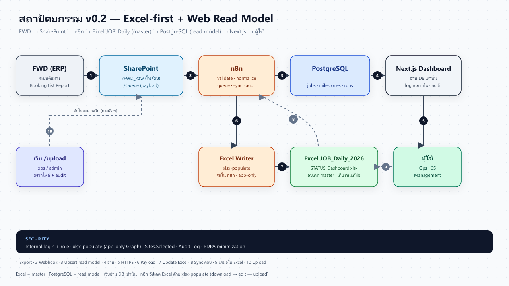

# แผนออกแบบระบบ Dashboard v0.2.1
## Excel-first: FWD → SharePoint → Excel → Read Model → เว็บ

> **v0.3 update (28/10/2026):** SharePoint ถูกถอดออกและเปลี่ยนเป็น **Web-only** — ดู [FWD-Dashboard-Plan-v0.3-TH.md](FWD-Dashboard-Plan-v0.3-TH.md) (เอกสารนี้เก็บไว้เป็นประวัติ/ทางเลือก)

| | |
|---|---|
| **เวอร์ชัน** | 0.2.1 (ถอด Power Automate/Office Script ออก) |
| **วันที่** | 28 ตุลาคม 2026 |
| **การเปลี่ยนแปลงจาก v0.1** | คง Excel เป็นไฟล์ทำงานหลัก, ตัด Entra ID SSO ของผู้ใช้, ตัด Microsoft Teams, เปลี่ยนตัวเขียน Excel เป็น **n8n + xlsx-populate** |
| **เอกสารอ้างอิง** | `FWD-Dashboard-Plan-TH.md` (v0.1 — รายละเอียดการวิเคราะห์ไฟล์/security) |

> **v0.2.1 (28/10/2026):** ถอด **Power Automate + Office Script** ออกจากสถาปัตยกรรมหลัก — ใช้ **n8n + xlsx-populate** ในการอัปเดต Excel แทน (ทดสอบกับไฟล์จริงแล้ว) โดยเก็บ PA/Office Script ไว้เป็น **fallback** เฉพาะกรณีที่ต้องการแก้ Excel ขณะมีคนเปิดไฟล์อยู่

> **เป้าหมายตามที่กำหนด:** หลัง Export จาก FWD แล้วนำไฟล์เข้า SharePoint ระบบต้องอัปเดต Excel `JOB_Daily_2026 STATUS_Dashboard` และเว็บไซต์ต้องอัปเดตตาม

---

## 0. สรุปผู้บริหาร

### 0.1 Flow ใหม่ (5 ขั้น)

1. **FWD Export** → อัปโหลดผ่านเว็บ `/upload` (หรือวางที่ SharePoint `/FWD_Raw/`)
2. **n8n** ตรวจ schema, normalize, กันข้อมูลซ้ำ
3. **n8n + xlsx-populate** ดาวน์โหลด workbook → แก้เฉพาะคอลัมน์ master → อัปโหลดกลับ (ไม่แตะคอลัมน์ที่คนกรอก)
4. **n8n** อ่าน workbook กลับ → upsert เข้า PostgreSQL (read model)
5. **เว็บ Next.js** อ่าน PostgreSQL → ผู้ใช้เห็นข้อมูลใหม่ภายใน 15 นาที

### 0.2 บทบาทของแต่ละส่วน

| ส่วน | บทบาท | สถานะ |
|---|---|---|
| Excel `JOB_Daily_2026 STATUS_Dashboard.xlsx` | **ไฟล์ทำงานหลัก (operational master)** | คงไว้ตามที่ต้องการ |
| PostgreSQL | **Read model** สำหรับเว็บ + ประวัติ/audit | ใหม่ |
| n8n | ตรวจ/แปลง/ประสานงาน/**แก้ Excel**/sync | มีอยู่แล้ว |
| Excel Writer (`xlsx-populate`) | โมดูลใน n8n สำหรับ download → edit → upload | ใหม่ (ไม่ต้อง license เพิ่ม) |
| เว็บ Next.js | แสดงผลและค้นหา (อ่าน DB) | ใหม่ |
| SharePoint | จุดรับไฟล์ + เก็บ Excel/รายงาน | มีอยู่แล้ว |

### 0.3 ข้อจำกัดที่ต้องยอมรับ

**n8n เรียก Graph Excel API แบบ app-only ไม่ได้** (Microsoft ระบุว่า Excel range API ไม่รองรับ application permission — [เอกสาร Microsoft](https://learn.microsoft.com/en-us/graph/api/range-update?view=graph-rest-1.0&tabs=http)) แต่ n8n **ดาวน์โหลดไฟล์ทั้งก้อน → แก้ด้วย `xlsx-populate` → อัปโหลดกลับ** ได้ เพราะ Graph file download/upload รองรับ app-only

> จึง **ไม่จำเป็นต้องใช้ Power Automate/Office Script** ในเส้นทางหลัก — เก็บไว้เป็น fallback เมื่อต้องแก้ Excel ขณะมีคนเปิดไฟล์ (co-authoring)

### 0.4 ระยะเวลา

**8–10 สัปดาห์** ถึง Go-live (กระชับกว่า v0.1 เพราะ Excel ยังเป็น master ไม่ต้องย้ายการกรอกข้อมูลทั้งหมด)

---

## 1. สถาปัตยกรรมและลำดับการทำงาน



| # | ขั้น | ผู้รับผิดชอบ | SLA |
|---|---|---|---|
| 1 | FWD export → อัปโหลดเว็บ `/upload` (หรือ SharePoint `/FWD_Raw`) | ผู้ใช้ / RPA | ทันทีที่อัปโหลด |
| 2 | ตรวจ + normalize + กันซ้ำ | n8n | < 10 วินาที |
| 3 | Checkout → download → แก้ Excel (xlsx-populate) → upload → checkin | n8n | < 2 นาที (ถ้าไฟล์ว่าง) |
| 4 | อ่าน Excel กลับ → PostgreSQL | n8n | < 30 วินาที |
| 5 | เว็บเห็นข้อมูลใหม่ | Next.js cache 60s | < 3 นาที |
| 6 | Sync งานที่แก้มือใน Excel | n8n (ทุก 15 นาที) | < 15 นาที |

### 1.1 หลักการ

1. **Excel เป็น master** — ข้อมูลที่คนเห็นและแก้ไขอยู่ใน Excel
2. **ประมวลผลทันทีที่อัปโหลด** — ไม่รอรอบเวลา; ถ้าไฟล์ถูกล็อกให้รอ/retry
3. **เว็บไม่อ่าน Excel โดยตรง** — อ่าน read model เพื่อความเร็ว/ความปลอดภัย
4. **เขียน Excel เฉพาะคอลัมน์ master** — คอลัมน์ที่คนกรอก (draft, DO, clear, remark) ไม่ถูกแตะ
5. **ทุกการเปลี่ยนแปลงมี log** — `_SyncLog` ใน Excel + `sync_runs` ใน DB
6. **ไม่ใช้ Teams** — แจ้งเตือนอยู่ในหน้า Data Health (และอีเมลถ้าต้องการ)

---

## 2. ข้อจำกัด Graph Excel และทางเลือก

### 2.1 ข้อเท็จจริง

| API | Application permission | ผล |
|---|---|---|
| Graph Excel range update | **ไม่รองรับ** | n8n app-only เขียนเซลล์ไม่ได้ |
| Graph file download (`/content`) | รองรับ `Files.Read.All` | n8n อ่านไฟล์ทั้งก้อนได้ |
| Graph file upload | รองรับ `Files.ReadWrite.All` (ทับทั้งไฟล์) | ใช้ร่วมกับ xlsx-populate เพื่อรักษา chart/สูตร |
| Office Scripts run | ต้องใช้บัญชีผู้ใช้ (delegated) | ต้องมี Power Automate หรือ token ผู้ใช้ |

### 2.2 ทางเลือก

| ทาง | กลไก | รักษาสูตร/chart | ข้อดี | ข้อเสีย | แนะนำ |
|---|---|---|---|---|---|
| **A. Power Automate + Office Script** | n8n เขียน JSON ลง `/Queue` → PA trigger → Run script | ✅ | แก้ขณะไฟล์เปิดได้ (co-authoring) | ต้องมี E3/E5 + PA; เพิ่ม component | fallback |
| B. Service account token ใน n8n | n8n ใช้ OAuth2 ของบัญชี service → Graph Excel API | ✅ (range update) | n8n ตัวเดียว | token หมดอายุ/CA/MFA; บัญชีมีสิทธิ์แก้ไฟล์; เสี่ยง | ไม่แนะนำ |
| C. Regenerate workbook | อ่าน template → เขียนไฟล์ใหม่ → upload ทับ | ❌ (chart/format อาจหาย) | ควบคุมได้ 100% | สูญเสีย manual columns/charts; ไม่ใช่ in-place | ทางเลือกสำรอง |
| D. Excel Desktop RPA | Power Automate Desktop เปิด Excel | ✅ | ใช้ Excel จริง | ต้องมีเครื่องเปิดตลอด; fragile | ไม่แนะนำ |
| **E. xlsx-populate (ใน n8n)** | ดาวน์โหลด → แก้เซลล์ → อัปโหลดทับ | ✅ (ทดสอบกับไฟล์จริงแล้ว) | ไม่ต้อง PA/Office Script; เร็ว (~1.5 วิ) | แทนไฟล์ทั้งก้อน; ชนถ้าไฟล์เปิดอยู่ | **แนะนำ** |

### 2.3 เหตุผลที่เลือก E (n8n + xlsx-populate)

- n8n ทำได้ทั้งหมด: ดาวน์โหลด workbook (app-only), แก้เซลล์, อัปโหลดกลับ — ไม่ต้องมี orchestrator ที่สอง
- ทดสอบกับไฟล์จริงแล้ว: 25 ชีต, 15 charts, 41 รูป, สูตร, merged cells, defined names ยังอยู่ครบ
- ไม่ต้องมี license Power Automate/Office Scripts เพิ่ม
- ข้อแลกเปลี่ยน: แทนไฟล์ทั้งก้อน → ต้องจัดการตอนไฟล์ไม่ถูกเปิด (checkout/checkin หรือช่วงเวลาที่กำหนด)
- ถ้าจำเป็นต้องแก้ขณะมีคนเปิดไฟล์ตลอด → ใช้ **A (Office Script)** เป็น fallback

### 2.4 Primary: n8n + xlsx-populate (ขั้นตอน)

1. `GET /drives/{driveId}/items/{itemId}/content` → ดาวน์โหลด workbook
2. parse ไฟล์ FWD ที่อัปโหลด → normalize
3. เปิด workbook ด้วย `xlsx-populate` → สร้าง `Map<jobNo, row>` ต่อชีต
4. update เฉพาะ master cells; แถวใหม่ append ท้าย + ใช้ format ที่ pre-format ไว้
5. patch `fullCalcOnLoad="1"` ใน `xl/workbook.xml`
6. `PUT /content` อัปโหลดเป็น version ใหม่ (พร้อม `If-Match` ETag)
7. ดาวน์โหลดกลับมาตรวจ (row count/spot check) → sync DB

**ประมวลผลทันทีหลังอัปโหลด + การจัดการไฟล์ถูกล็อก**

- เริ่ม pipeline ทันทีที่ผู้ใช้กดอัปโหลด (ไม่รอรอบเวลา)
- ใช้ `POST /checkout` ก่อนแก้ และ `POST /checkin` หลังอัปโหลด
- อัปโหลดด้วย `If-Match` (ETag) เพื่อกันเขียนทับงานที่เพิ่งเปลี่ยน
- ถ้าได้ `423 Locked` / `409 Conflict` → retry ทุก 30 วินาที ไม่เกิน 15 นาที
  - ระหว่างรอ: สถานะ `waiting_for_lock` บนหน้า upload
  - สำเร็จ/หมดเวลา: แจ้งเตือนในหน้า Data Health
- ถ้าไฟล์ถูกเปิดค้างและมีงานยังไม่บันทึก → checkout อาจรบกวนผู้ใช้; ต้องแจ้งล่วงหน้า/มีข้อความบนหน้า upload
- เก็บ version history + backup ก่อนเขียนทุกครั้ง

**ข้อควรระวัง**
- อย่า copy style ทั้ง object ไปแถวใหม่ (ทำให้ stylesheet เสีย) → pre-format แถวว่างล่วงหน้า
- วันที่: เขียนเป็น `Date` + number format `dd/mm/yyyy`
- งานซ้ำ: ใช้ key `(jobNo, service, etd)`; ซ้ำจริง → quarantine
- `xlsx-populate` v1.21.0 ค่อนข้างเก่า → pin version + ทดสอบ; ถ้ากังวลใช้ fork ที่ดูแลอยู่

---

## 3. Fallback: Office Script (ถ้าต้อง live edit)

> หัวข้อนี้เก็บไว้เป็นทางเลือกสำรอง กรณีที่ต้องอัปเดต Excel ขณะมีคนเปิดไฟล์อยู่ตลอด และยอมจ่าย license Power Automate/Office Scripts
> ถ้าใช้เส้นทางหลัก (n8n + xlsx-populate) ไม่ต้องอ่านหัวข้อนี้

### 3.1 เตรียม template

- [ ] เพิ่มชีต `_SyncLog` เก็บ `timestamp, file, sheet, action, job_no, field, old, new, run_id`
- [ ] กำหนด **เจ้าของคอลัมน์** ให้ชัด (ทำสีหัวตารางหรือ comment)
- [ ] ตรวจว่า job no อยู่คอลัมน์คงที่ทุกชีต (SEA Import D, AIR Import D, Air Export F, SEA Export G)
- [ ] เพิ่ม Data Validation สำหรับ `STATUS` (ลดการพิมพ์ผิด)
- [ ] สำรองไฟล์ต้นฉบับก่อนเริ่มใช้จริง

| กลุ่มคอลัมน์ | ตัวอย่าง | ใครเขียน |
|---|---|---|
| **Master** | STATUS, ETD, ETA, CUSTOMER NAME, MBL/HBL, CUS.INV | ระบบ (Office Script) |
| **Manual** | draft ใบขน, ยิงใบขน, แลก DO, Clear & Pickup, เอกสารเบิกเงิน, Remark | คน |

### 3.2 Office Script `upsertJobs`

**Input (JSON)**
```json
{
  "runId": "2026-10-28T09:30:00Z-abc123",
  "sourceFile": "FWD_Booking_20261028.xlsx",
  "jobs": [
    {
      "jobNo": "SHAI26100044",
      "service": "AIR Import",
      "status": "Job Control",
      "etd": "2026-10-27",
      "eta": "2026-10-27",
      "customer": "SAVE LOGISTICS(THAILAND) CO.,LTD.",
      "bl": "WUS-T-2026033"
    }
  ]
}
```

**Logic**
1. เปิดชีตตาม `service`
2. สร้าง `Map<jobNo, row>` จากคอลัมน์ job no
3. ถ้ามีอยู่ → update เฉพาะ master cells
4. ถ้าไม่มี → append แถวใหม่ท้ายตาราง + copy format จากแถวก่อนหน้า
5. เขียน `_SyncLog` ต่อรายการ
6. คืนค่า `{updated, added, skipped, errors}`

**ข้อควรระวัง**
- เขียนวันที่เป็น ISO string แล้วกำหนด number format `dd/mm/yyyy`
- อย่าใช้ `getUsedRange()` ทั้งชีต (ช้า); กำหนดช่วงจากแถวสุดท้าย
- จำกัด batch ≤ 500 แถวต่อ run; ถ้าเกินให้แบ่ง
- ตรวจ `jobNo` ซ้ำก่อน append

### 3.3 Trigger: Queue pattern (ใช้ trigger SharePoint มาตรฐาน)

1. n8n เขียน `payload_<runId>.json` ลง `/Queue/`
2. Power Automate trigger **When a file is created (properties only)** ใน `/Queue/`
3. PA อ่านเนื้อหา → action **Run script from SharePoint library** (เก็บ script ไว้ในไลบรารีของ site) → เขียนผลลัพธ์ `result_<runId>.json` ลง `/Queue/Results/`
4. n8n poll `/Queue/Results/` ทุก 30 วินาที (หรือรับ webhook ภายใน)
5. ลบไฟล์ใน `/Queue/` หลังสำเร็จ (เก็บ 7 วัน)

> ถ้ามี Power Automate Premium ใช้ **HTTP trigger** เรียกจาก n8n ตรง ๆ ได้ ง่ายกว่าและ latency ต่ำกว่า
> ตรวจสอบก่อนว่า license/connector **Excel Online (Business)** ขององค์กรใช้ action นี้ได้ ([เอกสาร Microsoft](https://learn.microsoft.com/en-us/office/dev/scripts/develop/power-automate-integration?tabs=run-script))

### 3.4 Conflict rules

| สถานการณ์ | การจัดการ |
|---|---|
| คนแก้ master column | ระบบเขียนทับในรอบถัดไป — ต้องแจ้ง/ฝึก |
| คนแก้ manual column | ระบบไม่แตะ; sync กลับ DB ตามปกติ |
| 2 รอบเขียนพร้อมกัน | PA concurrency = 1; queue ต่อคิว |
| ไฟล์ถูกเปิดล็อก | PA retry 3 ครั้ง (30s, 2m, 10m) |
| Script error | เขียน `_SyncLog` + `result` = failed; n8n หยุดและแจ้ง Data Health |

### 3.5 Rollback

- ใช้ SharePoint version history ย้อนกลับได้ทันที
- `_SyncLog` เก็บค่า old/new ต่อ field
- ก่อน run แรกของวัน เก็บ snapshot ไฟล์ไว้ที่ `/Backup/YYYYMMDD/`

### 3.6 กติกาที่ต้องตกลงก่อนเขียนจริง

| เรื่อง | กติกา |
|---|---|
| งานซ้ำ 8 เลขงาน | ใช้ key `(jobNo, service, etd)` ในการหาแถว; ถ้าซ้ำจริงให้ quarantine + แจ้ง ไม่ merge เงียบ ๆ |
| Status variants | เขียนค่า canonical: `Job Complete`, `Job Control`, `Job Waiting`, `Job Cancelled` (อย่าเขียน `CANCELED`/`ยกเลิก Job`) |
| แถวใหม่ | append ต่อท้ายแถวสุดท้ายของชีตนั้น + copy format; ห้ามแทรกกลาง |
| วันที่ | ถ้า FWD ให้ค่าเป็น text ให้แปลงเป็น `Date` ก่อนเขียน; กำหนด format `dd/mm/yyyy` |
| ชื่อลูกค้า | เก็บชื่อดิบ; การ normalize ทำใน DB ไม่ใช่ใน Excel |
| คอลัมน์ที่ห้ามแตะ | draft, ยิงใบขน, แลก DO, Clear & Pickup, เอกสารเบิกเงิน, Remark |

---

## 4. Read Model และการ Sync

### 4.1 n8n อ่าน Excel อย่างไร

- ดาวน์โหลดไฟล์ทั้งก้อนผ่าน Graph `GET /drives/{driveId}/items/{itemId}/content` (app-only `Files.Read.All` รองรับ)
- parse ด้วย `Spreadsheet File` node หรือ SheetJS
- อ่านทั้ง 4 ชีต + `Transport` + `clearing`
- normalize เหมือน v0.1 (status/date/job no/customer)

### 4.2 ตารางใน PostgreSQL

| ตาราง | หน้าที่ |
|---|---|
| `jobs` | ข้อมูลงานจาก Excel (master + manual) |
| `job_milestones` | ขั้นตอนงาน (draft/customs/DO/clear/advance) |
| `transport_jobs` | เที่ยวขนส่ง |
| `advances` | เบิกเงิน/clearing |
| `sync_runs` | log การ sync (file hash, rows, errors) |
| `audit_log` | การดู/export/แก้ไขบนเว็บ |

### 4.3 Trigger การ sync

| Trigger | ความถี่ | หมายเหตุ |
|---|---|---|
| หลัง Excel writer สำเร็จ | ทันที | เร็วที่สุด |
| Scheduled | ทุก 15 นาที | เก็บงานที่แก้มือ |
| Manual | admin กด | หน้า Data Health |

### 4.4 Data freshness

- แสดง `Last synced from Excel: 28/10/2026 09:45` บน header
- ถ้าเกิน 30 นาที → badge เหลือง; เกิน 2 ชม. → แดง
- หน้า Data Health แสดง: จำนวนแถว, duplicates, parse errors, milestone fill rate

---

## 5. เว็บไซต์

### 5.1 บทบาทของเว็บ (ต้องยืนยัน)

| แบบ | ความหมาย | ขอบเขต |
|---|---|---|
| **A. Read-only mirror (แนะนำ Phase 1)** | เว็บแสดงข้อมูลที่ sync จาก Excel; ผู้ใช้แก้ข้อมูลใน Excel | 2–3 สัปดาห์ |
| **B. Edit on web (Phase 2)** | ผู้ใช้แก้ status/milestone บนเว็บ → เขียนกลับ Excel ผ่าน Excel writer | +2–3 สัปดาห์ |
| **C. Trigger only** | เว็บมีปุ่ม "Sync now" ให้ admin สั่ง run pipeline | +2–3 วัน |

### 5.2 หน้าเว็บ (Phase 1)

| Route | เนื้อหา |
|---|---|
| `/overview` | KPI, charts, งานเกินกำหนด, freshness |
| `/jobs` | ตารางค้นหา/filter/export |
| `/jobs/[jobNo]` | timeline + ข้อมูลจาก Excel |
| `/transport` | ตู้/เที่ยว |
| `/advances` | เบิกเงิน/clearing |
| `/data-health` | sync runs, errors, duplicates, milestone fill rate |
| `/admin` | users/roles |

### 5.3 Stack

Next.js 16 (App Router) + TypeScript + Tailwind + Recharts + TanStack Table + Drizzle/Prisma + Auth.js (Credentials/LDAP) — **ไม่ใช้ Entra SSO**

### 5.4 Auth ภายใน

| ทาง | วิธี | หมายเหตุ |
|---|---|---|
| A. Local account (แนะนำ) | Argon2id + role ใน DB + TOTP สำหรับ admin | ไม่พึ่ง IdP |
| B. Windows AD (LDAPS) | domain account + AD group | เหมาะกับ on-prem |
| C. IP allowlist | ไม่มี login | ไม่แนะนำ — ไม่มี audit รายคน |

---

## 6. ความปลอดภัย (ปรับตามข้อกำหนด)

### 6.1 สิ่งที่ตัดออก

- ❌ Entra ID SSO สำหรับผู้ใช้เว็บ
- ❌ Microsoft Teams แจ้งเตือน
- ❌ การใช้ Graph Excel API แบบ app-only (ไม่รองรับ) — ใช้ download/upload แทน

### 6.2 สิทธิ์

| ระบบ | สิทธิ์ |
|---|---|
| n8n → SharePoint | `Sites.Selected` + `read/write` เฉพาะ site; ใช้ดาวน์โหลด/อัปโหลดไฟล์ + เขียน `/Queue` |
| n8n → PostgreSQL | `ingest_writer` (upsert jobs/sync_runs) |
| Web → PostgreSQL | `web_reader` (SELECT) |
| n8n → Excel | Graph `read/write` เฉพาะไฟล์นี้; ใช้ download → edit → upload (app-only) |
| ผู้ใช้ → เว็บ | local account/AD + role |

### 6.3 สิทธิ์ของ n8n สำหรับ Excel

- ใช้ app registration ของ n8n + `Sites.Selected` เฉพาะ site; ไม่ใช้บัญชีคน
- จำกัดสิทธิ์เฉพาะ SharePoint site + ไฟล์ Excel/โฟลเดอร์ `/FWD_Raw` `/Queue`
- ใช้ certificate/secret ใน Key Vault; rotate ตามรอบ
- ตรวจ audit log ของ app/service ทุกเดือน
- มีแผน revoke/rotate และทดสอบ

### 6.4 Excel security

- Sensitivity label `Confidential`
- จำกัด external sharing + DLP
- ใช้ SharePoint version history + backup รายวัน
- `_SyncLog` เก็บว่าใคร/เมื่อไร/แก้อะไร (ฝั่งระบบ)
- ถ้าคนแก้มือ ต้องมี audit จาก SharePoint (version history)

### 6.5 แจ้งเตือนแทน Teams

- หน้า `/data-health` แสดงสถานะสี (เขียว/เหลือง/แดง)
- ถ้าต้องการ push: ใช้อีเมลผ่าน Outlook (optional) หรือ LINE Notify (optional)
- ไม่มี Teams ตามข้อกำหนด

### 6.6 PDPA

- เก็บเฉพาะข้อมูลที่จำเป็น; ไม่ ingest เลขบัตรประชาชนคนขับ
- Mask เบอร์โทรใน UI
- Retention: ไฟล์ดิบ 90 วัน, `_SyncLog` 1 ปี, DB 24–36 เดือน
- Audit การเข้าถึง/export

---

## 7. แผนดำเนินงาน (8–10 สัปดาห์)

| Phase | ระยะ | ผลลัพธ์ |
|---|---|---|
| 0. Discovery + Spike | 1 สัปดาห์ | ทดสอบ xlsx-populate กับสำเนาไฟล์จริง + เปิดด้วย Excel; วัดเวลา; ทดสอบ checkout/upload |
| 1. Foundation | 2 สัปดาห์ | PostgreSQL, n8n, internal auth, SharePoint structure, repo/CI |
| 2. Excel Pipeline | 2 สัปดาห์ | xlsx-populate writer + checkout/checkin + `_SyncLog` + sync Excel → DB |
| 3. Website | 2–3 สัปดาห์ | Overview, Jobs, Detail, Transport, Advance, Data Health |
| 4. Hardening + UAT | 2 สัปดาห์ | Pen test, load test, UAT, runbook, training |
| 5. Go-live | 1 สัปดาห์ | Cutover + hypercare |

**Spike สัปดาห์แรกต้องตอบให้ได้:**
- อัปเดตไฟล์จริงแล้ว chart 15 ตัว/สูตรยังอยู่ไหม; เปิดด้วย Excel ได้ไม่มี repair
- ใช้เวลากี่วินาทีต่อ 100 แถว; หน่วยความจำเท่าไร
- อัปโหลดทับขณะไฟล์ถูกเปิด/ล็อกได้ไหม; checkout/checkin ทำงานหรือไม่
- ถ้าล็อกบ่อย ต้องมีช่วง sync ตอนไหน

---

## 8. Acceptance Criteria

| ด้าน | เกณฑ์ |
|---|---|
| Excel update | ไฟล์ถูกอัปเดตภายใน 2 นาทีหลังอัปโหลด (ถ้าไฟล์ไม่ถูกล็อก); ถ้าล็อก → queued + แจ้ง Data Health |
| Web freshness | เว็บเห็นข้อมูลภายใน 3 นาทีหลังอัปโหลด |
| Accuracy | จำนวนงานตรงกับ Excel 100%; 0 duplicate; rejects < 0.5% |
| Manual columns | ไม่ถูกเขียนทับ 100% (ตรวจด้วย diff ก่อน/หลัง) |
| Charts/formulas | ยังทำงานครบ 5 charts หลังรัน 10 รอบ |
| Audit | `_SyncLog` + `sync_runs` ครบทุก run |
| Security | Login บังคับ; ไม่มี Teams; least privilege ผ่าน review |
| Performance | หน้าเว็บ p95 < 1.5s |

---

## 9. สิ่งที่ต้องตัดสินใจ

| # | คำถาม | ค่าเริ่มต้น |
|---|---|---|
| 1 | ยืนยันใช้ **xlsx-populate** (ไม่ใช้ PA) ได้ไหม? | ใช้ |
| 2 | ถ้า Excel ถูกล็อกนานเกิน 15 นาที ให้ทำอย่างไร? | แจ้ง admin + คิวรอ |
| 3 | **"อัปเดตผ่านเว็บไซต์" หมายถึง** (a) เว็บแสดงข้อมูลใหม่อัตโนมัติ หรือ (b) แก้ข้อมูลบนเว็บแล้วเขียนกลับ Excel? | (a) ก่อน |
| 4 | อนุญาตให้ n8n มีสิทธิ์ write เฉพาะไฟล์ Excel นี้ไหม? | อนุญาต |
| 5 | Login ผู้ใช้: local account / Windows AD / ไม่มี login? | local account |
| 6 | ใครแก้คอลัมน์ master ได้บ้าง? | ระบบเท่านั้น |
| 7 | ต้องการอีเมลแจ้งเตือนแทน Teams ไหม? | ไม่ต้อง (ใช้ Data Health) |
| 8 | FWD export ตั้งเวลาเองได้ไหม? | ถ้าไม่ได้ใช้ manual |
| 9 | Hosting: Azure SEA หรือ on-prem? | on-prem/Azure ตามนโยบาย |

---

## 10. สิ่งที่เปลี่ยนจาก v0.1 (สรุป)

| หัวข้อ | v0.1 | v0.2 |
|---|---|---|
| แหล่งความจริง | PostgreSQL | **Excel** |
| Excel | รายงานที่สร้างใหม่ | **ไฟล์ทำงานหลัก (in-place update)** |
| เว็บ | อ่าน PostgreSQL | อ่าน PostgreSQL read model |
| การเขียน Excel | ไม่แนะนำ | **n8n + xlsx-populate** |
| Login | Entra SSO | **local account / AD** |
| แจ้งเตือน | Teams | **Data Health (ไม่ใช้ Teams)** |
| ระยะเวลา | 10–12 สัปดาห์ | **8–10 สัปดาห์** |
| ความเสี่ยงหลัก | Excel พัง | **Excel write conflict / สูตรเสีย** |

---

## 11. Web Upload + Excel Writer (ผลทดสอบจริง)

> เพิ่มตามข้อเสนอ: ให้ผู้ใช้อัปโหลดไฟล์ FWD เข้าเว็บแอป แล้วระบบอัปเดตทั้ง Excel และเว็บ

### 11.1 ทำไมอัปโหลดผ่านเว็บดีกว่า

- ควบคุมสิทธิ์ (เฉพาะ ops/admin) และตรวจไฟล์ก่อนรับ
- ผู้ใช้เห็นผลทันที: กี่แถวเพิ่ม/อัปเดต/ปฏิเสธ
- ไม่ต้องพึ่ง SharePoint webhook หรือให้ผู้ใช้เข้า SharePoint
- มี audit ว่าใครอัปโหลด เมื่อไร ไฟล์อะไร
- ไฟล์ยังเก็บใน SharePoint `/FWD_Raw` เบื้องหลัง (versioning/retention เดิม)

### 11.2 Flow

1. ผู้ใช้ลากไฟล์ที่หน้า `/upload` → ระบบเริ่มประมวลผลทันที
2. API ตรวจ type/size/magic bytes/hash/role → เก็บไฟล์ลง `/FWD_Raw` + สร้าง `uploads` row
3. เรียก n8n webhook ภายใน (HMAC) หรือให้ n8n เฝ้า SharePoint ตามเดิม
4. n8n parse + normalize + validate
5. Excel writer (ดู 11.3) อัปเดต `JOB_Daily_2026 STATUS_Dashboard.xlsx`
6. n8n อ่าน workbook กลับ → upsert PostgreSQL
7. หน้า upload แสดงสถานะ; dashboard เห็นข้อมูลใหม่

### 11.3 Excel writer: 2 ทางที่ใช้ได้จริง

| | **A. Office Script + Power Automate** | **E. xlsx-populate worker** |
|---|---|---|
| วิธี | แก้เซลล์ใน Excel Online | ดาวน์โหลด → แก้ด้วย library → อัปโหลดทับ |
| รักษา chart/สูตร | ✅ | ✅ (ทดสอบกับไฟล์จริงแล้ว) |
| License | ต้องมี M365 + PA | ไม่ต้องเพิ่ม |
| Concurrent edit | ปลอดภัยกว่า (co-authoring) | แทนไฟล์ทั้งก้อน → ชนถ้าไฟล์เปิดอยู่ |
| ความเร็ว | ไม่กี่วินาที | ~1.5 วินาที + upload |
| เหมาะกับ | อัปเดตระหว่างวัน | อัปเดตตามรอบ/ไฟล์ปิด |

### 11.4 ผลทดสอบ xlsx-populate กับไฟล์จริง

ทดสอบกับ `JOB_Daily_2026 STATUS_Dashboard.xlsx` (7.38 MB):

| รายการ | ผล |
|---|---|
| โหลดไฟล์ | 637 ms |
| บันทึกไฟล์ | ~800 ms |
| ชีต | 25 ชีต ครบ |
| Charts | 15 (Dashboard 5) ครบ |
| Drawings / รูปภาพ | 11 / 41 ครบ |
| Defined names | 29 ครบ |
| Merged cells / สูตร | ครบ |
| แก้เซลล์ + append แถว + วันที่ | สำเร็จ; เปิดด้วย openpyxl ได้ |
| ขนาดไฟล์ | 7.38 MB → 7.06 MB (recompression) |

**ข้อควรระวังจากการทดสอบ**
- อย่า copy style ทั้ง object ไปยังแถวใหม่ (ทำให้ stylesheet เสีย) → ใช้การ pre-format แถวว่างใน template หรือ copy เฉพาะ numberFormat
- ต้อง patch `fullCalcOnLoad="1"` ใน `xl/workbook.xml` เพื่อให้ Excel คำนวณสูตรใหม่เมื่อเปิด
- การอัปโหลดทับทั้งไฟล์ต้องทำตอนไฟล์ไม่ถูกเปิด หรือใช้ checkout/checkin + retry; ถ้าล็อกให้ queue แล้วแจ้ง Data Health
- ควรทดสอบเปิดไฟล์ด้วย Excel จริงก่อน Go-live (spike 1 วัน)

### 11.5 ข้อแนะนำ

- **ค่าเริ่มต้น: E (n8n + xlsx-populate)** — ประมวลผลทันทีหลังอัปโหลด; ไม่ต้อง license เพิ่ม
- ถ้าทีมแก้ Excel ระหว่างวันตลอดและต้องการ live edit → **A (Office Script)** เป็น fallback
- ใช้ E + checkout/checkin; ถ้า lock ไม่ได้ให้ retry ทุก 30 วิ (ไม่เกิน 15 นาที) และแจ้ง Data Health
- ไม่ว่าทางไหน ให้เก็บ SharePoint version history + backup ก่อนเขียน

### 11.6 ความปลอดภัยของ Upload

- เฉพาะ role `ops`/`admin`; ตรวจ CSRF
- Whitelist `.xlsx`, `.csv`; ตรวจ MIME + magic bytes (ไม่เชื่อนามสกุล)
- จำกัดขนาด ≤ 25 MB และจำนวนแถว ≤ 50,000
- ป้องกัน zip bomb (xlsx เป็น zip) และ password-protected file
- สแกนไวรัส (Defender/ClamAV) ก่อนประมวลผล
- เก็บไฟล์นอก webroot; ตั้งชื่อสุ่ม; ไม่ execute
- Rate limit 5 ไฟล์/ชั่วโมง/คน; audit ทุกครั้ง

### 11.7 UX หน้า Upload

- Drag & drop + แสดงชื่อ/ขนาด/เวลา
- คำแนะนำ: ปิด Excel ก่อนอัปโหลด เพื่อให้อัปเดตได้ทันที
- Progress: Uploading → Validating → Updating Excel → Syncing web → Done
- ถ้าไฟล์ถูกล็อก: Waiting for Excel (พร้อมเวลาที่รอ) → Done / Timeout
- สรุปผล: total / added / updated / rejected / duplicates
- ดาวน์โหลด error report ได้
- ประวัติการอัปโหลดย้อนหลัง 30 วัน + สถานะ waiting/timeout

### 11.8 คำถามที่ต้องตอบ

1. ให้ **Web Upload เป็นช่องทางหลัก** แทนการวางไฟล์ใน SharePoint ใช่ไหม?
2. ระหว่างอัปเดต Excel มีคนเปิดไฟล์อยู่บ่อยแค่ไหน?
3. ยืนยันใช้ **n8n + xlsx-populate** (ไม่ใช้ Power Automate) ใช่ไหม?

---

*เอกสาร v0.2 — ปรับได้ตามคำตอบในหัวข้อ 9 และ 11.8*
