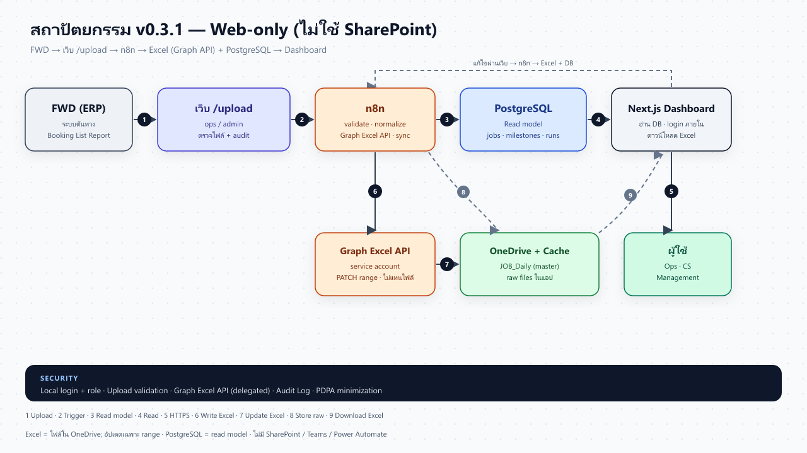

# แผนออกแบบระบบ Dashboard v0.3.1
## Web-only: FWD → เว็บอัปโหลด → Excel (Graph API) + Dashboard

| | |
|---|---|
| **เวอร์ชัน** | 0.3.1 (Graph Excel API ผ่าน service account) |
| **วันที่** | 28 ตุลาคม 2026 |
| **การเปลี่ยนแปลงหลัก** | ไม่ใช้ SharePoint ในเส้นทางอัปโหลด, ใช้ **Graph Excel API** อัปเดต Excel ใน OneDrive โดยตรง (ไม่แทนไฟล์), Excel และเว็บอัปเดตจากชุดข้อมูลเดียวกัน |
| **เอกสารก่อนหน้า** | v0.1 (วิเคราะห์ไฟล์), v0.2 (Excel-first + SharePoint) |

> **v0.3.1:** เปลี่ยนตัวเขียน Excel จาก `xlsx-populate` เป็น **Graph Excel API** ตามสิทธิ์ของ service account ที่มีอยู่ — แก้เฉพาะ range, ไม่แทนไฟล์ทั้งก้อน, chart/สูตรอยู่ครบ และไม่ต้องใช้ Power Automate

> **เป้าหมาย:** ผู้ใช้อัปโหลดไฟล์ FWD ที่หน้าเว็บ → ระบบอัปเดต Excel และเว็บไซต์จากข้อมูลชุดเดียวกัน → ทั้งสองแสดงผลตรงกัน

---

## 0. สรุปผู้บริหาร

### 0.1 Flow (6 ขั้น)

1. **อัปโหลด** ไฟล์ FWD ที่หน้า `/upload` (เฉพาะ ops/admin)
2. **ตรวจ + เก็บไฟล์ดิบ** ใน storage ของแอป
3. **n8n** parse + normalize + กันข้อมูลซ้ำ → ชุดข้อมูลกลาง
4. **n8n + Graph Excel API** อัปเดตเฉพาะ range ใน workbook ที่อยู่ใน OneDrive (ใช้ service account token)
5. **n8n** upsert PostgreSQL (read model) จากชุดข้อมูลเดียวกัน
6. **เว็บ Next.js** อ่าน DB + ให้ดาวน์โหลด/เปิด Excel → ผู้ใช้เห็นทั้งสองอัปเดตพร้อมกัน

### 0.2 องค์ประกอบ

| ส่วน | บทบาท |
|---|---|
| เว็บ Next.js | รับอัปโหลด, dashboard, ดาวน์โหลด Excel, admin |
| n8n | orchestration: parse, validate, เขียน Excel, sync DB |
| Graph Excel API | อัปเดต range ใน workbook (delegated token) |
| PostgreSQL | read model + audit/log |
| App Storage | เก็บไฟล์ FWD ดิบ |
| OneDrive | ที่เก็บ workbook `JOB_Daily_2026 STATUS_Dashboard.xlsx` |
| ไม่มี | SharePoint upload, Teams, Entra SSO, Power Automate |

### 0.3 หลักการสำคัญ

1. **One dataset, two outputs** — Excel และเว็บสร้างจากชุดข้อมูลเดียวกัน
2. **ทันทีหลังอัปโหลด** — ไม่มีรอบเวลา
3. **แก้เฉพาะเซลล์ ไม่แทนไฟล์** — Graph range update รักษา chart/สูตร
4. **ทุก run มี log** — `uploads`, `sync_runs`, `audit_log`
5. **Excel ยังเป็นไฟล์ที่ทีมใช้** — แต่ไม่ใช่ฐานข้อมูลของเว็บ

---

## 1. สถาปัตยกรรมและลำดับการทำงาน



| # | ขั้น | ผู้รับผิดชอบ | SLA |
|---|---|---|---|
| 1 | อัปโหลด + ตรวจไฟล์ | เว็บ | < 10 วิ |
| 2 | parse + normalize | n8n | < 10 วิ |
| 3 | อัปเดต Excel | n8n + xlsx-populate | < 30 วิ |
| 4 | upsert PostgreSQL | n8n | < 10 วิ |
| 5 | เว็บเห็นข้อมูล | Next.js (cache 60s) | < 2 นาที |
| 6 | ดาวน์โหลด Excel | เว็บ | ทันที |

### 1.1 ทำไมไม่ใช้ SharePoint

- ลด dependency/สิทธิ์ที่ต้องดูแล
- ผู้ใช้ไม่ต้องสลับไปมา SharePoint
- ควบคุม validation/audit ที่จุดเดียว
- ไม่ต้องพึ่ง webhook/Graph site permissions
- Excel อยู่ใน OneDrive + version history; ไฟล์ FWD ดิบเก็บใน storage ของแอป

---

## 2. Excel อยู่ที่ไหน

### 2.1 ตำแหน่งปัจจุบัน

จาก config ใน workflow เดิม (`CS Mailbox Backfill - Job Folders.json`) ไฟล์ `JOB_Daily_2026 STATUS_Dashboard.xlsx` อยู่ใน **OneDrive ของบัญชีที่ใช้ใน workflow** (สือผ่าน share link `bookingReportShareUrl`) ไม่ได้อยู่ใน SharePoint site library

- Graph Excel API ต้องมีไฟล์อยู่ใน drive (OneDrive หรือ SharePoint) — ตำแหน่งปัจจุบันใช้ได้
- ไม่ต้องย้ายไฟล์และไม่ต้องอัปโหลดขึ้น SharePoint
- ผู้ใช้ที่ได้รับ share link ยังเปิด/แก้ไฟล์ได้เหมือนเดิม

### 2.2 ทางเลือกที่เก็บ (ระยะยาว)

| | **OneDrive ปัจจุบัน (เริ่มต้น)** | **SharePoint team site** | **App Storage** |
|---|---|---|---|
| Graph Excel API | ✅ | ✅ | ❌ (ไม่มี drive) |
| เจ้าของไฟล์ | บัญชีบุคคล | ทีม/องค์กร | แอป |
| ความเสี่ยง | เจ้าของลาออก/ย้าย → ไฟล์หาย | ต่ำ | ไม่ใช่ไฟล์ที่ทีมเปิด |
| แก้มือ | ได้ | ได้ | ไม่ได้ |
| แนะนำ | ใช้ก่อน | **เป้าหมายระยะยาว** | ไม่ใช้กับ Excel |

### 2.3 ข้อควรระวัง

- ไฟล์อยู่ใน OneDrive ส่วนตัว → **bus factor**: ถ้าบัญชีถูกปิด ระบบหยุดและไฟล์อาจหาย
- ควรย้ายไป **SharePoint team site** หรือ OneDrive ของ service account ที่มีเจ้าของชัดเจน ก่อน Go-live
- การย้ายทำได้โดยไม่ต้องแก้ pipeline — เปลี่ยนแค่ driveId/itemId หรือ share URL ใน config

---

## 3. ทำให้ Excel กับเว็บอัปเดต “ด้วยกัน”

### 3.1 ลำดับที่ปลอดภัย

```
upload → parse → [1] เขียน Excel → [2] upsert DB → [3] mark success
```

- ถ้า **[1] ล้มเหลว** → ไม่แตะ DB; สถานะ failed; ไฟล์เดิมยังอยู่
- ถ้า **[1] สำเร็จ แต่ [2] ล้มเหลว** → retry DB; สถานะ `excel_ok_db_pending`; เว็บยังเก่าจนสำเร็จ
- ถ้า **[2] สำเร็จ** → mark success; เว็บเห็นข้อมูลใหม่

### 3.2 กติกา

| เรื่อง | กติกา |
|---|---|
| Run ID | หนึ่ง run ต่อหนึ่งการอัปโหลด; ใช้ idempotency key |
| เขียนซ้ำ | รันซ้ำต้องได้ผลเท่าเดิม (hash + upsert) |
| Partial update | ไม่อนุญาตให้ Excel อัปเดตแต่ DB ไม่ตาม — ต้อง retry จนครบหรือแจ้ง |
| สถานะ | หน้า upload แสดง Excel ✅ / Web ✅ แยกกัน |
| ล้มเหลว | เก็บ payload ไว้ให้ retry โดยไม่ต้องอัปโหลดใหม่ |

### 3.3 ตัวอย่างสถานะ

`queued → parsing → writing_excel → syncing_db → success`
หรือ `failed_excel`, `failed_db`, `waiting_for_lock`

---

## 4. Storage และไฟล์

### 4.1 โครงสร้าง

```
data/
  raw/2026/10/<sha256>.xlsx        # ไฟล์ FWD ที่อัปโหลด
  cache/JOB_Daily_latest.xlsx       # สำเนาสำหรับดาวน์โหลด (optional)
  logs/                             # sync/audit
```

- **Excel master** อยู่ใน OneDrive (ตำแหน่งเดิม) — ไม่ copy มาเก็บถาวรในแอป
- App Storage เก็บเฉพาะไฟล์ FWD ดิบ + cache สำหรับดาวน์โหลด
- Version ของ Excel ใช้ **OneDrive version history** เป็นหลัก

### 4.2 Retention

| ชนิด | เก็บ |
|---|---|
| ไฟล์ FWD ดิบ | 90 วัน |
| Excel version | ตาม OneDrive version history (แนะนำ 30–90 วัน) |
| Cache | 7 วัน |
| Log | 1 ปี |

### 4.3 ความปลอดภัยของไฟล์

- ไฟล์ดิบเก็บนอก webroot; ชื่อเป็น hash
- ดาวน์โหลดผ่าน API ที่ตรวจ login + role
- ไม่ให้ directory listing
- OneDrive/SharePoint ใช้ version history + recycle bin
- สำรองข้อมูล nightly + test restore

---

## 5. การอัปโหลด

### 5.1 Validation

- เฉพาะ role `ops`/`admin`
- `.xlsx`, `.csv`; ตรวจ MIME + magic bytes
- ≤ 25 MB, ≤ 50,000 แถว
- กัน zip bomb / password-protected
- สแกนไวรัสก่อนประมวลผล
- คำนวณ SHA-256; ถ้าเคยอัปโหลดสำเร็จแล้ว → เตือน/ข้าม

### 5.2 UX

- Drag & drop
- Progress: Uploading → Validating → Updating Excel → Syncing web → Done
- สรุป: total / added / updated / rejected / duplicates
- ถ้า Graph ตอบ 423/429: Waiting & retry พร้อมแสดงสถานะ
- ประวัติ 30 วัน + ดาวน์โหลด error report

---

## 6. ความปลอดภัย

### 6.1 สิ่งที่ไม่มีในระบบนี้

- ❌ SharePoint ในเส้นทางอัปโหลด (Excel อยู่ใน OneDrive/SharePoint ตามที่เก็บ)
- ❌ Microsoft Teams
- ❌ Entra ID SSO (ใช้ local account หรือ AD)
- ❌ Power Automate / Office Script

### 6.2 Auth ผู้ใช้

| ทาง | วิธี |
|---|---|
| A. Local account (แนะนำ) | Argon2id + role + TOTP สำหรับ admin |
| B. Windows AD (LDAPS) | domain account + group |
| C. IP allowlist | ไม่แนะนำ — ไม่มี audit รายคน |

### 6.3 สิทธิ์

| ระบบ | สิทธิ์ |
|---|---|
| เว็บ → storage | อ่าน/เขียนเฉพาะโฟลเดอร์ `data/` |
| n8n → storage | อ่าน raw, อ่าน/เขียน excel |
| เว็บ → PostgreSQL | `web_reader` |
| n8n → PostgreSQL | `ingest_writer` |

### 6.4 Audit/PDPA

- `audit_log`: ใครอัปโหลด/ดาวน์โหลด/ดูข้อมูล
- ไม่ ingest เลขบัตรประชาชนคนขับ; mask เบอร์โทร
- Retention ตามข้อ 4.2
- Backup + access review ทุกไตรมาส

---

## 7. แผนดำเนินงาน (10 สัปดาห์)

| Phase | ระยะ | ผลลัพธ์ |
|---|---|---|
| 0. Spike | 1 สัปดาห์ | ทดสอบ Graph range write + calculate + เปิด Excel; ยืนยัน chart/สูตร/scope |
| 1. Foundation | 1–2 สัปดาห์ | Next.js, PostgreSQL, n8n, auth, storage |
| 2. Pipeline | 2 สัปดาห์ | upload → parse → Graph Excel update → DB + status |
| 3. Website | 2 สัปดาห์ | Overview, Jobs, Detail, Upload, Data Health |
| 3.5 Web Editing | 2 สัปดาห์ | ฟอร์มแก้ไข + writeback Excel + audit + conflict |
| 4. Hardening | 1–2 สัปดาห์ | Security, load test, UAT, runbook |

---

## 8. Acceptance Criteria

| ด้าน | เกณฑ์ |
|---|---|
| Excel update | ภายใน 30 วินาทีหลังอัปโหลด; แก้เฉพาะ range ไม่แทนไฟล์ |
| Web update | ภายใน 2 นาที; ตรงกับ Excel 100% |
| Consistency | Excel/Web มาจาก run เดียวกัน; มี status แยก |
| Manual columns | ไม่ถูกเขียนทับ |
| Charts/formulas | ครบ 15 charts หลังรัน 10 รอบ |
| Security | Login บังคับ; upload validation ผ่าน; token ไม่หลุด log |
| Audit | ทุก run/ดาวน์โหลดมี log |

---

## 9. สิ่งที่ต้องตัดสินใจ

| # | คำถาม | ค่าเริ่มต้น |
|---|---|---|
| 1 | ยืนยันใช้ Graph Excel API กับไฟล์ใน OneDrive ปัจจุบัน? | ใช่ |
| 2 | Credential มี scope `Files.ReadWrite` และเขียนไฟล์นี้ได้? | ต้องทดสอบ 1 range |
| 3 | ไฟล์จะอยู่ OneDrive ปัจจุบัน หรือย้ายไป team site? | OneDrive ก่อน, ย้ายก่อน Go-live |
| 4 | Login: local account / Windows AD? | local account |
| 5 | ใครอัปโหลดได้? | ops/admin |
| 6 | Hosting: on-prem/Azure? | on-prem/Azure ตามนโยบาย |

---

## 10. Graph Excel API (service account) — วิธีที่เลือก

### 10.1 หลักฐานจากโปรเจกต์เดิม

workflow `CS Mailbox Backfill - Job Folders.json` ใช้ credential `microsoftOAuth2Api` เรียก Graph:

- `GET /drives/{driveId}/items/{itemId}/workbook/worksheets` — อ่านชีต
- `GET .../worksheets/{name}/usedRange(valuesOnly=true)` — อ่านข้อมูล
- `PUT /drives/{driveId}/root:/...:/content` — เขียนไฟล์เข้า drive

→ แปลว่าบัญชี service มีสิทธิ์ **write ระดับไฟล์**; เมื่อเพิ่ม scope `Files.ReadWrite` จะเขียน range ผ่าน Excel API ได้ (delegated only)

### 10.2 ข้อดีเทียบทางเลือกอื่น

| | **Graph Excel API** | xlsx-populate | Office Script + PA |
|---|---|---|---|
| แก้เซลล์ในไฟล์จริง | ✅ | ❌ (แทนไฟล์) | ✅ |
| รักษา chart/สูตร | ✅ | ✅ | ✅ |
| File lock/co-authoring | ดีกว่า | เสี่ยง | ดี |
| License เพิ่ม | ไม่ต้อง | ไม่ต้อง | ต้องมี |
| ใช้ credential ที่มี | ✅ | ❌ | ❌ |

### 10.3 ขั้นตอนใน n8n

1. resolve share link → `GET /shares/{shareId}/driveItem` → `driveId`, `itemId`
2. `POST /workbook/createSession` → `sessionId` (ใส่ header `workbook-session-id` ทุก request)
3. `GET /workbook/worksheets` → รายชื่อชีต
4. `GET .../worksheets/{sheet}/usedRange(valuesOnly=true)` → ค่าปัจจุบัน
5. สร้าง `Map<jobNo, row>` + เทียบเฉพาะ field master ที่เปลี่ยน
6. สร้าง `PATCH .../range(address='C512:M512')` body `{ values: [[...]] }`
7. ยิงเป็น `$batch` ครั้งละ ≤ 20 requests
8. แถวใหม่ → `PATCH .../range(address='A{n}:P{n}')`
9. `POST /workbook/calculate` (Full) เพื่อให้ Dashboard สูตรใหม่
10. `POST /workbook/closeSession` (persist)
11. sync DB จาก dataset เดียวกัน

### 10.4 Error handling

| HTTP | การจัดการ |
|---|---|
| 429 | อ่าน `Retry-After` แล้วรอ/retry |
| 423 Locked | retry 3 ครั้ง (30s, 2m, 10m) |
| 409 session | สร้าง session ใหม่แล้ว retry |
| 401 token | refresh token / re-auth credential |
| 404 item moved | resolve share link ใหม่ |
| 207 batch | ตรวจ `responses[].status` ทุกตัว |

### 10.5 ความปลอดภัยของ token

- เป็น **delegated token** ของบัญชี service — ไม่ใช่ app-only
- จำกัดสิทธิ์บัญชีให้เข้าถึงเฉพาะไฟล์/โฟลเดอร์ที่ต้องใช้
- เปิด MFA/Conditional Access ตามนโยบาย; ตรวจ sign-in log ทุกเดือน
- เก็บ credential ใน n8n (encrypted) + `N8N_ENCRYPTION_KEY` ใน Key Vault
- ห้าม log token; ตั้ง execution pruning
- มี runbook เมื่อ token หมดอายุ/ถูก revoke

### 10.6 ความเสี่ยง: ไฟล์อยู่ใน OneDrive ส่วนตัว

- ถ้าบัญชีเจ้าของไฟล์ถูกปิด/ย้าย ระบบหยุดและไฟล์อาจหาย
- **ควรย้ายไป SharePoint team site หรือ OneDrive ของ service account ที่มีเจ้าของชัดเจนก่อน Go-live**
- การย้ายไม่ต้องแก้ pipeline — เปลี่ยนแค่ driveId/itemId หรือ share URL

### 10.7 Spike ที่ต้องทำ

- [ ] เขียน 1 cell + `calculate` + เปิด Excel → chart/สูตรยังอยู่
- [ ] เขียน 50 แถว → วัดเวลา/จำนวน request
- [ ] ทดสอบขณะมีคนเปิดไฟล์ (co-authoring)
- [ ] ยืนยัน scope `Files.ReadWrite` และสิทธิ์ edit ของบัญชี

---

## 11. แก้ไขข้อมูลผ่านเว็บ + เขียนกลับ Excel

**สเปกฉบับเต็ม:** [Web-Editing-Spec-TH.md](Web-Editing-Spec-TH.md)

### 11.1 Flow

```
เว็บฟอร์ม → PATCH /api/jobs/{jobNo} → job_edits (pending)
        → n8n webhook → Graph Excel PATCH → DB commit → done
```

- เว็บไม่เรียก Graph ตรง ๆ — **n8n เป็นผู้เขียน Excel เพียงคนเดียว**
- เขียน Excel ก่อน แล้ว commit DB; ถ้า Excel fail → DB ไม่เปลี่ยน
- ระหว่างบันทึกแสดง “กำลังอัปเดต Excel…” แล้วค่อย toast สำเร็จ

### 11.2 ฟิลด์และสิทธิ์

| กลุ่ม | ฟิลด์ | ใครแก้ |
|---|---|---|
| Master | status, ETD, ETA | ops/admin |
| Master (ละเอียดอ่อน) | customer, BL | admin |
| Manual | draft, ยิงใบขน, แลก DO, clear, advance, remark | ops |
| Read-only | jobNo, service, next action | — |

### 11.3 Conflict

- ทุก job มี `version`; เว็บส่ง version มาด้วย → ไม่ตรง = 409
- Excel แก้มือถูกตรวจด้วย polling (`lastModifiedDateTime` ทุก 5 นาที)
- ค่าเริ่มต้น: last-write-wins + audit; ถ้าเป็น master field → ให้ admin resolve

### 11.4 Audit

`job_edits` เก็บ who / field / old / new / source / status / timestamps
แสดงในแท็บ “ประวัติ” ของงาน + หน้า Data Health

### 11.5 Acceptance

| ด้าน | เกณฑ์ |
|---|---|
| เวลาบันทึก | < 3 วินาที |
| Consistency | Excel + DB ตรงกันหลัง success |
| Failure | Excel fail → DB ไม่เปลี่ยน; retry ได้ |
| Conflict | 409; ไม่มี lost update เงียบ |
| Audit | ครบทุก edit |

---

*เอกสาร v0.3.1 — ปรับได้ตามคำตอบในหัวข้อ 9 และ 11*
